# 10 — 12-Week Implementation Roadmap (single developer, local-first)

**Revision 0.3. The plan is §12: week 1 approved (W1–W3), weeks 2–12 approved as written (C5, 2026-11-21).** §5, §6 and §11 are kept as history.
Revision 0.2: reworked per Architecture Review 0.2 item 11; replaced the team-based Rev 0.1 plan.
Tags: [S] stated · [D] derived · [A] assumption · [R] recommendation

---

## 1. Planning assumptions

| Assumption | Value used | Source |
|------------|-----------|--------|
| Team | **One developer**, primarily a learning project | [S] Rev 0.2 #11 |
| Weekly capacity | **~20 h/week** (U12, Rev 0.3); plan in §12 | [S] |
| Goal of the 12 weeks | A working, production-shaped MVP-1 running in one AWS environment. Not a production launch. | [D] |
| Runtime | .NET 10 LTS | [S] Rev 0.2 #6 |
| Database | Hybrid DynamoDB + PostgreSQL | [S] Rev 0.2 #1 |
| MVP-1 scope | Tenancy with multiple locations, catalogue (food), menus, media, publishing, QR, public menu, tenant export/deletion (doc 14 §4) | [S] Rev 0.2 #7–10, Rev 0.3 |
| Out of the 12 weeks | Ordering, online payments, retail inventory, SaaS billing, **AI menu import + Claude API (phase 2)**, multi-account production environment | [S] #7, #9, U7, P19 |
| Environments | Local only in weeks 1–7 → one AWS account in weeks 8–12 → multi-account production in phase 2 | [S] Rev 0.2 #11 |

## 2. Principles [R]

1. **Local first.** Everything runs with `docker compose up` (or an Aspire AppHost), `dotnet run` and `ng serve`. Cloud work starts only once the domain works locally.
2. **One vertical slice at a time,** end to end: API, UI, tests and docs.
3. **Production-shaped code, small infrastructure.** Tenant isolation, outbox, idempotency, the publish state machine and architecture tests are built from the start. They're expensive to retrofit and they're what the learning is about. Multi-account AWS, Multi-AZ and the production network wait.
4. **Abstract only where local and cloud differ:** identity provider (standard OIDC: Keycloak locally, Cognito in AWS) and object storage (S3 API locally). Background jobs use the same SQS API everywhere (LocalStack locally, Amazon SQS in AWS; ADR-18).
5. **One new technology focus per week,** to limit learning overload.
6. **Every week has a core and a stretch goal.** Drop the stretch goal first.
7. **Write a short learning note or ADR each week** in `docs/`.

## 3. Implementation environment — version verification (week 1)

Review item 6 asks for supported versions to be **checked when the environment is prepared**, not assumed in these documents. Record the results in a versions note (`docs/architecture/versions.md`).

| Component | Decision | What to verify |
|-----------|----------|----------------|
| .NET SDK / ASP.NET Core / EF Core | **.NET 10 LTS** (accepted) | Latest patch; pin the SDK with `global.json` |
| Npgsql EF Core provider | Version matching EF Core 10 | Compatibility with the chosen PostgreSQL major |
| PostgreSQL | Latest major supported by **both** Amazon RDS and Npgsql | RDS supported-versions list; use the **same major** in Docker |
| Angular | Current **active or LTS** major | Angular release/support schedule; static build output (`outputMode`), prerendering and zoneless status in that version |
| Node.js | LTS version the chosen Angular CLI requires | Angular compatibility table |
| AWS SDK for .NET | Current major | DynamoDB, S3, STS packages |
| Terraform + AWS provider | Current stable | Native S3 state locking support |
| DynamoDB Local / LocalStack | Current | Transactions and GSIs in DynamoDB Local; S3 conditional writes (`If-None-Match`) and versioning in the LocalStack free edition (otherwise MinIO) |
| Keycloak | Current | OIDC realm import for test tenants |
| Anthropic SDK for C# | Phase 2 | Verify when AI menu import starts |

## 4. Local development environment [R]

| Concern | Local choice | AWS counterpart |
|---------|-------------|-----------------|
| PostgreSQL | Docker container (same major as RDS) | RDS PostgreSQL |
| DynamoDB | DynamoDB Local, with tables created from a shared table definition (also used by Terraform) | DynamoDB |
| Object storage | LocalStack S3 (or MinIO) | S3 |
| Background work | Amazon SQS API on LocalStack (`sqs` added to the existing 4.14.0 image in week 2); transactional outbox relay | Amazon SQS standard queues + DLQs (ADR-18); no DynamoDB Streams |
| Identity | Keycloak with a test realm (users in two tenants, every role) | Cognito |
| Email | Mailpit | SES |
| Observability | OpenTelemetry → Aspire dashboard or Jaeger | CloudWatch / X-Ray |
| Public "CDN" | Static file server for the public app plus the public-data bucket, with a rewrite rule for `/q/*` and `/m/*` | CloudFront + CloudFront Function |
| Claude API | Phase 2 | Phase 2 |

Option: a .NET Aspire AppHost can orchestrate the containers and projects and gives a local telemetry dashboard. It's a good learning fit but optional (doc 11 T3). **Decided (W3, 2026-11-21): plain Docker Compose.**

## 5. Roadmap (Rev 0.2 — superseded by §12)

| Week | Theme | Core deliverables | Stretch | Exit criteria |
|------|-------|-------------------|---------|---------------|
| **1** | Foundations (local) | Version verification (§3); repo; .NET 10 solution with module projects and **architecture tests**; docker compose; OpenTelemetry to the local dashboard; GitHub Actions CI (build + test only); Angular workspace with `admin` and `public` projects | Aspire AppHost | `docker compose up` + `dotnet test` green locally and in CI |
| **2** | Identity & tenancy | OIDC login via Keycloak; tenant sign-up; **multiple locations**; memberships, roles, permissions; `ITenantContext`; **PostgreSQL RLS** with `SET LOCAL`; audit events; **cross-tenant test harness** | Invitations by email (Mailpit); BFF cookie session | Two tenants; automated tests prove tenant A can't read or write B |
| **3** | Catalog + media | DynamoDB tables with **TenantIndex from day one**; food items, modifier groups, allergens/dietary tags; optimistic concurrency; presigned uploads to local S3; image-processing worker (validation, EXIF stripping, renditions) | Translations | Editor creates items with processed images |
| **4** | Menu authoring | Menus, sections, placements, overrides; drag-and-drop reorder (fractional ranks); menu-level locking; **location assignment** | Schedules | Full multi-section menu; concurrent edit shows the conflict UI |
| **5** | Publishing | Publish job state machine; optimistic snapshot read; content-addressed snapshots; **authoritative pointer transaction**; manifest builder (FIFO per location); reconciler; rollback; **failure-injection tests** (worker killed mid-build, S3 failure, concurrent publish, stale draft) | Rollback UI | Every failure scenario in doc 04 §4.1 is covered by an automated test |
| **6** | QR + public app | 128-bit QR codes; QR/route projection files; **static public app** (prerendered shell + client-side data); "unavailable"/"revoked" states; Lighthouse CI budget; axe accessibility checks | Allergen filter, language switch | Scan a QR with a real phone on the local network → menu shown within budget on a throttled profile |
| **7** | Consolidation | **Tenant export and deletion via TenantIndex** (DynamoDB + S3 + PostgreSQL); deletion job tracking; security checklist pass (applicable ASVS L2 items); refactoring; docs. **Buffer week.** | — | Deletion test proves zero remaining items or objects for a deleted tenant across all tables and buckets. **MVP-1 complete locally.** |
| **8** | First AWS environment (one account) | Account hardening (root MFA, IAM Identity Center user, **budget alarms**); Terraform: state bucket, cost-reduced VPC, DynamoDB, RDS (small, single-AZ), S3, CloudFront + CloudFront Function, ECR, ECS Fargate (API + worker), ALB, SQS, EventBridge Pipe | Custom domain + ACM | App reachable in AWS, provisioned by Terraform only |
| **9** | Cognito, delivery, operations | Switch identity to Cognito through configuration; GitHub Actions deploy with OIDC (no static keys); Secrets Manager; CloudWatch dashboards and alarms (DLQ depth, publish failures, 5xx); **WAF with rate rules**; QR miss-rate alarm | Scheduled scale-to-zero of ECS outside working hours | A push to `main` deploys; test alarms fire |
| **10** | AI menu import, part 1 *(pending product confirmation)* | AI job pipeline (SQS, worker, per-tenant quota, `ai_usage` metering); photo/PDF upload; Claude call with a strict structured-output schema; suggestions stored with TTL; refusal and error handling | — | A real menu becomes reviewable suggestions |
| **11** | AI menu import, part 2 | Review screen (accept, edit, reject → draft changes); **evaluation set** of ~20 real food menus; accuracy measures (exact price match, item recall, section mapping); prompt versioning | Description generation | Accuracy measured and recorded |
| **12** | Hardening & retrospective | PITR restore drills (DynamoDB, RDS); load test of the public path; DynamoDB **LeadingKeys** session policies (or schedule them as the first phase-2 task); cost review; threat model update; phase-2 plan | — | MVP-1 demo in AWS; phase-2 backlog prioritized |

If product does **not** confirm AI menu import by week 9, use weeks 10–11 for the phase-2 items with the most value (e.g., sold-out overlay, schedules, translations), chosen at that point.

### Dependency view

```mermaid
gantt
  dateFormat  X
  axisFormat  W%s
  section Local
  Foundations + versions          :a1, 1, 1
  Identity & tenancy (RLS)        :a2, 2, 1
  Catalog + media                 :a3, 3, 1
  Menu authoring                  :a4, 4, 1
  Publishing state machine        :a5, 5, 1
  QR + static public app          :a6, 6, 1
  Consolidation, deletion, buffer :a7, 7, 1
  section AWS (one account)
  First environment (Terraform)   :b8, 8, 1
  Cognito, CD, WAF, alarms        :b9, 9, 1
  Hardening & retrospective       :b12, 12, 1
  section Gated
  AI menu import (if confirmed)   :c10, 10, 2
```

## 6. Cut lines (Rev 0.2 — superseded by §12.3)

1. Behind at the end of week 4 → drop schedules, translations and invitations from MVP-1.
2. Behind at the end of week 6 → drop the rollback UI (keep rollback through an admin endpoint) and the allergen filter.
3. Behind at the end of week 9 → AI menu import moves to phase 2. It isn't needed for the core MVP-1 flow.
4. Never cut: tenant isolation tests, publish failure handling, tenant deletion and budget alarms.

## 7. AWS learning-environment cost controls [R]

No prices are listed here because they change. Check current AWS pricing before week 8.
- **Budget alarms on day one** of week 8 (e.g., at 50 %, 80 % and 100 % of a monthly limit you set).
- Watch the always-on costs: NAT Gateway, ALB, RDS, Fargate tasks and public IPv4 addresses.
- Avoid a NAT Gateway in the learning environment: use the free gateway endpoints for S3/DynamoDB, and run Fargate tasks in public subnets with a public IP and tight security groups. **This is a deliberate learning-environment deviation**; production uses private subnets (doc 04 §5.1).
- Single-AZ RDS, smallest suitable instance.
- Split Terraform into a `data` stack (kept) and a `compute` stack (can be destroyed or scaled to zero when you're not working).

## 8. Phase 2 (after week 12, not scheduled)

| Item | Note |
|------|------|
| Multi-account AWS Organization and production environment | Target topology in doc 04 §5.1 |
| DynamoDB LeadingKeys session policies (T1) | **Required gate before onboarding any real pilot tenant** (draft; §12.5) |
| External penetration test | **Required gate before the UAE commercial launch** (draft; §12.5) |
| SaaS billing and entitlements | Confirm timing (doc 11 U7) |
| Sold-out overlay, schedules, translations, analytics, custom domains | Product to prioritize |
| Ordering (pay at venue first), then online payments | Out of MVP-1 (ADR-12) |
| AI menu import + Claude API integration | ADR-15; first phase-2 candidate |

## 9. Single-developer risks

| Risk | Mitigation |
|------|-----------|
| Scope too large for one person | Core MVP-1 finishes locally in week 7; cut lines in §6 |
| Learning DynamoDB, AWS and Angular at the same time | Local first; one technology focus per week; access patterns already specified (doc 07) |
| Cloud cost surprises | Budget alarms; destroyable compute stack; no NAT Gateway in the learning environment |
| No second reviewer | Architecture tests, ADRs, automated code review, failure-injection tests |
| Local and cloud behave differently (Keycloak vs. Cognito; DynamoDB Local's immediately consistent GSIs) | Identity behind OIDC with contract tests (week 10); simulated index lag in tests; dispatch is identical everywhere (ADR-18) |

## 10. Definition of Done (every feature)

- Tenant isolation test for every new endpoint.
- Permissions defined and enforced.
- New DynamoDB items carry `TENANT_PK`/`TENANT_SK` (doc 07 §7).
- Audit event for security-relevant actions.
- Logs and traces carry tenant and correlation IDs.
- Infrastructure changes in Terraform only (from week 8).
- Accessibility checked (public and admin UI).
- Docs or ADR updated.

## 11. Rev 0.3 first proposal (superseded by §12; kept for history)

The Rev 0.2 plan above is kept for history. Once approved, this table replaces §5. **Why the change:** the sign-off review found weeks 1, 5 and 8 overloaded for one developer (publishing in a single week; the whole Terraform stack in a single week). The ADR-09/ADR-10 fixes add work, and per-module purge is safer when built alongside each module than at the end.

| Week | Theme | Core deliverables | Change from Rev 0.2 and why |
|------|-------|-------------------|-----------------------------|
| **1** | Foundations + verification | Version and library verification (incl. S3 conditional writes in LocalStack, image/QR library licences); solution + architecture tests (incl. the "no SDK writes outside `DynamoItemWriter`" rule); docker compose; CI; Angular workspace; **AWS account hardening + budget alarm + Terraform state bucket (no running resources)**; Anthropic key with spend limit; BFF decision recorded | OpenTelemetry moved to week 2 (load). The AWS bootstrap moved earlier to spread the learning, at no running cost. |
| **2** | Identity & tenancy | BFF login via Keycloak; provider-neutral identity (X-2); tenants, locations, roles/permissions, invitations; RLS; audit; OpenTelemetry; tenant-status gate; **deletion framework skeleton** (job tables, module purge interface, supervisor stub, tenancy/identity purge); OpenAPI output | Purge framework built early so every later module plugs in |
| **3** | Catalog + media | `DynamoItemWriter` (TI-1/TI-2) **before the first table**; catalog and **media** tables (X-1) with TenantIndex; items, modifiers, allergens, i18n maps (U5); uploads + WebP renditions; **catalog/media purge + coverage scan** | Write-path guarantee first; per-module purge |
| **4** | Menu authoring | Menus, sections, placements, reorder, locking (header edits bump META, PUB-4); location assignment; schedules (U6); sold-out flag; **menus purge** | — |
| **5** | Publishing core | ACTIVEJOB lock; jobs; work-index poller; claim/lease; optimistic snapshot read; content-addressed snapshot; commit transaction with tenant guard; MANIFEST state + builder; happy-path tests | Split from the single Rev 0.2 publishing week |
| **6** | Publishing robustness + QR | Failure-injection suite; reconciler; rollback (full state); unpublish; location deactivation; QR codes + QR/route projections; **publishing purge (projections first)** | Second half of publishing; QR moved here |
| **7** | Static public app | Shell + CSR; schedules; language switch; unavailable states; runtime UI dictionaries; Lighthouse + axe; in-app browser checks | Was week 6 |
| **8** | Deletion/export end-to-end + **local MVP-1 gate** | Orchestration, verification passes, S3 versions, identity handling, export; **all pre-AWS tests (doc 12 §9.5)**; buffer | Dedicated week; explicit gate before AWS |
| **9** | First AWS environment | Terraform: VPC (cost-reduced), DynamoDB, RDS, S3, two hostnames + CloudFront + Function, WAF in `us-east-1`, ECR, Fargate, ALB, SQS | Region (U2) and domain needed beforehand |
| **10** | Cognito, delivery, operations | Cognito via configuration; GitHub Actions OIDC deploy; Secrets Manager; dashboards and alarms; PITR restore drill; public-path load test; cost review | Restore drill and load test moved earlier from week 12 |
| **11–12** | AI menu import *(if ADR-15 confirmed by end of week 9)* | Job pipeline, structured outputs, review screen, evaluation set, quotas | Otherwise: phase-2 items + hardening |

Cut lines (§6) still apply. Adjusted: if behind at the end of week 6, rollback stays API-only and unpublish is done through an admin endpoint. With ~20 h/week (U12), weeks 1–8 plus week 9 are the realistic 12-week target.

## 12. Roadmap — Rev 0.3 (weeks 2–12 approved as written, C5, 2026-11-21)

**Approved 2026-11-21 (C5, doc 13 §1d):** weeks 2–12 as written below. Planned work is **not** moved, deferred or removed because of the available time. If the work runs behind, the **end date slips** and the order is kept (§12.3). Background jobs use **Amazon SQS** via a transactional outbox relay (ADR-18, accepted 2026-11-21); the SQS items below follow from that decision and don't move any work.

Rev 0.3 notes: Region `me-central-1` proposed (ADR-17; week-1 feasibility check only, region decision before the pilot environment). Market packs and Arabic/RTL add about 3–5 days. **The protected tests are not squeezed**: if the work doesn't fit, the timeline moves (§12.3).

**Week 1 approved (W1–W3, 2026-11-21):** week-1 foundation work may start (C5 has since been approved for weeks 2–12). Scope: the week-1 row below, **without** Keycloak (week 2, after ADR-06) and **without** the `DynamoItemWriter` and its architecture rule (week 3, after ADR-09). No running AWS application resources and no real tenant data. Local orchestration: plain Docker Compose. Later weeks are gated by doc 13 §1c.

**Why revised:** the product owner set U12 to **about 20 hours/week**. Learning priorities, in order: (1) DynamoDB modelling + distributed consistency, (2) AWS + Terraform, (3) Angular, (4) security fundamentals (identity, BFF/OIDC, tenant isolation), (5) testing, CI/CD, observability and production readiness. **AI menu import and the Claude API integration move to phase 2.** The 12 weeks focus on **local MVP-1 plus the first AWS environment**. Critical consistency, tenant-isolation and recovery tests are **protected**: when time runs short, feature scope shrinks or the timeline moves, never these tests.

### 12.1 Plan (about 240 hours)

| Week | Theme | Core deliverables | Learning focus |
|------|-------|-------------------|----------------|
| 1 | Foundations | Version/library verification; `git init`; .NET 10 solution + architecture tests; docker compose; **CI (build + test)**; Angular workspace; ~~budget alarm + Terraform state bucket~~ (moved to week 9 by the product owner, 2026-11-22; §12.7); **`me-central-1` service/version check** (public sources) (feasibility only; input to the ADR-17 region decision before the pilot environment) | 5, 2 |
| 2 | Identity & tenancy | BFF cookie session via Keycloak; provider-neutral identity; tenants, multiple locations, roles/permissions; **RLS**; tenant-status gate; audit; **cross-tenant test harness**; deletion framework skeleton; **minimal SQS: LocalStack `sqs`, transactional outbox relay, consumer with DLQ** (used by the deletion skeleton); OpenTelemetry locally | 4, 5 |
| 3 | Catalog + media | `DynamoItemWriter` (tagging, no upserts); catalog + media tables with TenantIndex; items, modifiers, i18n maps; **market packs** (US pilot + UAE skeleton), canonical allergen codes + schemes, halal/pork/alcohol fields, Arabic name normalization; uploads + WebP (**media processing on the SQS `media` queue**, SkiaSharp); **coverage scan**; catalog/media purge | 1 |
| 4 | Menu authoring | Menus, sections, placements, reorder, menu locking (header bumps META), location assignment, schedules (weekly + date-range overrides), sold-out flag; Angular admin editor with RTL support; menus purge | 1, 3 |
| 5 | Publishing core | ACTIVEJOB lock, jobs, **publishing-specific SQS work** (`publishing` queue + DLQ on the week-2 relay/consumer, idempotent job and manifest handlers), lease, optimistic snapshot read, content-addressed snapshot, guarded commit, MANIFEST state + builder | 1 |
| 6 | Publishing robustness + QR | **Failure-injection suite**, reconciler, rollback (full state), unpublish, location deactivation; QR codes + QR/route projections; publishing purge | 1 |
| 7 | Static public app | Prerendered shell + CSR, schedules, language switch, unavailable states, runtime UI dictionaries (`en` + `ar`), **Arabic/RTL** with Arabic font in budget, price-display policy; **Lighthouse + axe + RTL checks in CI** | 3, 5 |
| 8 | Deletion/export + **local MVP-1 gate** | Deletion orchestration, supervisor, verification passes, S3 versions, identity handling, export; **all protected tests green** (§12.2) | 1, 4, 5 |
| 9 | First AWS environment | **Start of the AWS phase (§12.7):** AWS SSO profile, bootstrap (state bucket + budget alert) from the locally prepared Terraform, pending AWS checks A3–A5. Terraform: cost-reduced VPC, DynamoDB, RDS, S3, **SQS queues + DLQs**, two hostnames + CloudFront + Function, WAF (`us-east-1`), ECR, Fargate, ALB as a **temporary test deployment in `us-east-1`** (§12.6: deploy, test, tear down; only state storage and the budget alert persist). The ADR-17 pilot/launch region stays Proposed | 2 |
| 10 | Identity + delivery in AWS | Cognito via configuration; **CD with GitHub Actions OIDC**; Secrets Manager; DB migrations as a deployment step; token contract tests against Cognito | 2, 4, 5 |
| 11 | Observability & operations | OpenTelemetry → CloudWatch/X-Ray; dashboards; alarms (5xx, SQS DLQ depth and oldest-message age, outbox relay backlog, stuck jobs, publish/manifest failures, purge failures, QR misses, budget); log retention; WAF rate rule | 5, 2 |
| 12 | Production readiness | **PITR restore drills** (DynamoDB, RDS) + projection rebuild from scratch in AWS; public-path load test; security review against the checklist; runbooks (publish stuck, purge failed, restore); cost review; retrospective + phase-2 plan | 5, 4 |

### 12.2 Protected tests (never cut to fit the schedule)

**Unchanged by the market-split draft (2026-11-21).** The ~3–5 days of localization work are absorbed by the §12.3 flex scope or by moving the timeline, never by reducing these tests. Arabic/RTL checks are added to CI as **additional** checks; they don't replace anything below.
1. Cross-tenant isolation for every endpoint; RLS (no tenant → zero rows; no pooled-connection leakage; no BYPASSRLS for the app role).
2. TenantIndex coverage scan across all tables; architecture rule "no DynamoDB writes outside `DynamoItemWriter`".
3. Tenant deletion end-to-end, including crash/resume, in-flight job races, no downstream writes triggered by purge (outbox/handlers skip non-active tenants), S3 versions, multi-tenant users, and the other tenant intact (doc 12 §3.3).
4. Publish consistency: failure injection at each step, concurrent requests (409), stale draft, retry after FAILED, rollback/republish, unpublish, manifest rebuild convergence, simulated index lag, **duplicate and redelivered SQS messages, crash between commit and send (outbox relay)**.
5. Recovery: projection rebuild from authoritative state (local and AWS); PITR restore drills (week 12).
6. Optimistic concurrency on menu and header edits.

### 12.3 Priority order if behind (C5, 2026-11-21: nothing is cut or deferred; the end date slips)

All items below stay in the plan. If the work runs behind, the schedule extends and these items are done **last, in this order**; §12.2 is never touched.
1. Email invitations (owner creates users directly instead).
2. Editing UI for more than two languages and side-by-side translation views (Arabic + English entry and display stay in scope; the full multi-language UI is required before the UAE launch).
3. Rollback UI (keep the API endpoint).
4. QR PDF print sheet (keep PNG/SVG).
5. CSV export (keep JSON).
6. Allergen filter in the public app (allergen display stays).
7. Week 11–12 items beyond the protected restore drill: load test, then dashboard polish.

If weeks 1–8 overrun, the whole schedule moves out in order (the AWS weeks start later); the local MVP-1 gate is never compressed and no planned work is removed.

### 12.4 Moved to phase 2
AI menu import (ADR-15, still the first AI capability, behind human review) and the Claude API integration, plus everything already listed in §8.

**UAE launch readiness (after the US pilot):** UAE market pack verified (allergen scheme, halal/pork/alcohol rules, VAT display), full multi-language editing UI, UAE legal track (PDPL, Arabic notices), production environment (doc 04 §5.1).

### 12.5 After week 12: pilot preparation, onboarding and the pilot (draft 2026-11-21; not part of the 12-week plan)

**The 12-week plan ends with the AWS environment ready** (week 12). Everything below happens afterwards and is **not** counted in the 12 weeks.

| Phase | What happens | Rough duration at ~20 h/week | Exit gate |
|-------|--------------|------------------------------|-----------|
| A. Pilot readiness | Safeguards G1–G11 from doc 04 §5.3, including **T1 tenant-scoped access policies (required)**; pilot-specific monitoring (synthetic checks, CloudFront log reports, support log) | 2–3 weeks | **G1–G11 done** and the doc 04 §5.3 assessment reviewed by the product owner |
| B. Pilot legal (L-US) | Pilot terms (UAE storage and single-AZ disclosure), privacy notice, incident contact | Runs in parallel with A | **G12 done** |
| C. Recruitment and onboarding | Recruit 5–10 US venues; onboard in small batches | 2–3 weeks (overlaps A–B; onboarding only after A and B) | ≥ 5 venues onboarded |
| D. Pilot | 6–8 weeks with real venues and guests; weekly review of the core measures (doc 01 §11) | 6–8 weeks | End of pilot |
| E. Evaluation | Core measures, interviews, go/no-go for UAE launch preparation | ~1 week | Decision by the product owner |

**Required gates (draft):**
- **Before onboarding any real pilot tenant:** T1 tenant-scoped DynamoDB access policies (doc 11 T1), plus safeguards G2–G12 (doc 04 §5.3).
- **Before the UAE commercial launch:** an **external penetration test**, plus the UAE launch readiness items in §12.4 and the production topology (doc 04 §5.1).

### 12.6 Temporary AWS test deployments (product owner, 2026-11-21)

- **When:** only in the final AWS phase (weeks 9–12); nothing is deployed to AWS before then (§12.7, 2026-11-22).
- **Region:** `us-east-1` for test deployments (weeks 9–12 and any later test runs). This is a test region only; it is **not** the ADR-17 pilot/launch region decision, and ADR-17 stays Proposed.
- **Lifecycle:** deploy for a test run, run the tests (including the week-12 restore drills), then **tear the test resources down**. Database data may be discarded. Test deployments are **not production-ready** and never hold real tenant data.
- **What persists between runs:** only what test runs need: the Terraform state bucket and the AWS budget alert (separate `bootstrap` Terraform configuration). Everything else belongs to the destroyable `test` configuration.
- **Teardown targets only MenuX test resources:**
  1. Separate Terraform root modules and state files: `infrastructure/terraform/bootstrap` (persistent; the state bucket has `prevent_destroy`) and `infrastructure/terraform/test` (destroyable). `terraform destroy` is only ever run in `test`, after reviewing its plan.
  2. Every test resource is tagged `project = menux`, `environment = test` (provider `default_tags`) and named with the prefix `menux-test-`.
  3. Test-only settings so teardown completes: RDS `deletion_protection = false` and `skip_final_snapshot = true`; DynamoDB deletion protection off; test S3 buckets `force_destroy = true`; ECR `force_delete = true`.
  4. After destroy, a leftover check lists anything still tagged `project = menux, environment = test` (Resource Groups Tagging API) and reports it; nothing outside those tags is touched.
- **Cost guard:** the $25/month budget alert is a notification, not a spending cap; teardown after each run is the real cost control.

### 12.7 AWS work happens only in the final AWS phase (product owner, 2026-11-22)

- **No AWS resources before the final AWS phase (weeks 9–12, the end of the project).** Nothing is deployed and no `terraform apply` runs before then: no state bucket, budget alert, GitHub OIDC provider, IAM deployer role or test environment.
- **No AWS access needed before then:** no AWS SSO profile, account ID or AWS credentials are required for weeks 2–8.
- **Terraform is prepared locally:** `infrastructure/terraform/bootstrap` and `infrastructure/terraform/test` are written and checked offline with `terraform fmt -check` and `terraform validate` (after `terraform init -backend=false`, which downloads providers but doesn't touch AWS). No `terraform plan` against AWS.
- **Local development and testing continue** on the Docker stack (PostgreSQL, DynamoDB Local, LocalStack S3/SQS, Keycloak, Mailpit).
- **Pending until the final AWS phase** (each marked "pending AWS" where it appears):

| # | Item | Done in |
|---|------|---------|
| A1 | AWS SSO profile `menux` and the account ID (existing account; root MFA and Identity Center confirmed by the product owner) | Start of week 9 |
| A2 | Bootstrap: Terraform state bucket (`us-east-1`, encryption, versioning, public access blocked) and the USD 25/month budget alert | Start of week 9 |
| A3 | PostgreSQL version check: RDS PostgreSQL 18 available in `us-east-1` (`aws rds describe-db-engine-versions`) | Week 9, before the RDS Terraform |
| A4 | `terraform plan`/`apply` for bootstrap and test; first test deployment and teardown | Week 9 |
| A5 | LocalStack vs AWS behaviour (S3 conditional writes and versioning, SQS DLQ and redrive) confirmed against real AWS | Weeks 9–10 |
| A6 | GitHub OIDC provider and deployer role for the test pipeline (proposal pending product-owner decision) | Week 10 |
| A7 | Cognito token contract tests against real Cognito | Week 10 |
| A8 | Restore drills and projection rebuild in AWS | Week 12 |
| A9 | `me-central-1` account-level checks (opt-in region, RDS versions there) | Before the pilot environment (ADR-17) |
