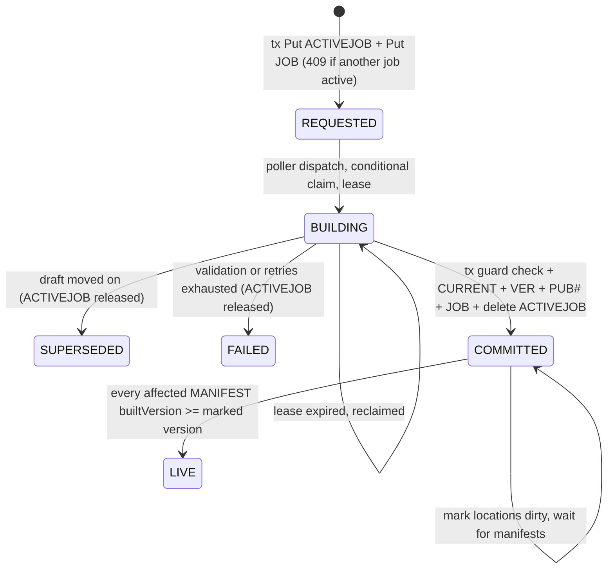

# 12 — Architecture Sign-off and Implementation-Readiness Review

Revision **0.3 (draft for approval)** · Date: 2026-11-19 · Source of truth reviewed: Rev 0.2 documents 01–11.

> **Approved 2026-11-21** with no exceptions (doc 13) and applied in the **Rev 0.3 baseline** (doc 14). This document is kept unchanged below as the review record. Where the baseline refined a recommendation while applying it (no SQS, no Streams, MANIFEST lease instead of FIFO; doc 14 §3), docs 01–11 are authoritative.
>
> Original status at review time: proposal only. **No ADR status has been changed.** Accepted decisions (ADR-01, 02, 03, 07, 12, 13, 14, 16) are not altered. The changes recommended here for the *proposed* ADRs are marked in the affected documents with a "⚠ Sign-off review" note and are only applied to the designs once approved. **Application implementation must not start until the decisions in §10 are approved.**

Finding IDs used below: **TI-n** TenantIndex · **PUB-n** publishing · **X-n** cross-document conflict · **R-n** risk.

---

## 1. Architecture sign-off checklist

Legend: ✅ ready · ⚠ ready once the listed change or decision is approved · ❌ blocking

| # | Area | Status | Notes |
|---|------|:-:|-------|
| 1 | Product scope for MVP-1 defined | ⚠ | Final scope in §8. Needs approval of the U3–U13 defaults (§6). |
| 2 | Accepted ADRs consistent with each other | ✅ | No conflicts found among ADR-01, 02, 03, 07, 12, 13, 14, 16. |
| 3 | Proposed ADRs reviewed | ⚠ | All 7: **Approve with changes** (§2, §5). None needs reconsidering. |
| 4 | Tenant isolation design (pooled, layered) | ✅ | Doc 09 §4. |
| 5 | Tenant data enumeration and deletion | ⚠ | ADR-09 approach is sound; **13 gaps** to close (TI-1…TI-13). Two are high severity. |
| 6 | Publishing consistency | ⚠ | ADR-10 approach is sound; **2 high-severity defects** (PUB-1, PUB-2) and 6 medium. |
| 7 | Public path (static) and hosting | ⚠ | ADR-04/05 sound; split admin and public hostnames (X-5). |
| 8 | Identity (Keycloak locally → Cognito) | ⚠ | Provider-neutral user identity columns needed (X-2). |
| 9 | Cross-document consistency | ⚠ | 10 conflicts (X-1…X-10), all minor to medium; fixes listed. |
| 10 | Versions verified (.NET 10 / PostgreSQL / Angular / LocalStack features) | ❌ until week 1 | A week-1 task by design (doc 10 §3). It blocks coding of the affected parts only, not sign-off. |
| 11 | Data retention and deletion policy | ⚠ | Defaults proposed (U13); legal review depends on the launch market (U2). |
| 12 | Roadmap realistic for one developer | ⚠ | Weeks 1, 5 and 8 are overloaded. Rev 0.3 roadmap proposed (doc 10 §11). |
| 13 | Pre-AWS automated test gate defined | ✅ | §9.5. |
| 14 | Cost controls for the learning environment | ✅ | Doc 10 §7. |
| 15 | Open product decisions | ⚠ | §10 lists only the ones that need your input. |

**Sign-off verdict (proposed):** the architecture is **ready for implementation once** the §10 decisions are approved and the required changes for ADR-09 and ADR-10 are folded in. No structural rework is needed.

---

## 2. Proposed ADR reviews

### ADR-04 — Customers read static projections, never the database

**In simple terms:** everything a guest's phone downloads (the app, the QR lookup, the list of live menus, the menu itself) is a file on S3 served by CloudFront. No server code or database runs when a guest scans a QR code.

**Why it fits Menu Studio:** guest traffic is spiky (meal times), read-only and identical for every guest of a venue, so it's ideal for a CDN. Each scan costs almost nothing, public menus keep working during API or database outages, and the .NET API only serves the low-volume admin portal.

**Risks, limits, complexity**
- Changes take seconds to appear (publish, revoke, suspension), bounded by TTLs and invalidations.
- Three sequential small fetches after the shell (QR file → manifest → snapshot) add latency on slow networks.
- No HTTP 302 on QR scan: resolution happens in the browser, so the QR target isn't visible to scanner previews (minor).
- Real-time state (sold out) needs a separate overlay file.
- Operationally: projections must be kept in sync (that's ADR-10's job).

**Conflicts found**
- **X-5:** Doc 04 §3 serves admin and public from one distribution (`/admin/*`, `/q/*`). Doc 09 §3 expects a separate admin hostname and BFF cookies. If the public app and the admin session share an origin, an XSS bug in the public app could reach the admin session. **Fix:** two hostnames (e.g., public `menu.<domain>` with no cookies, admin + API on `app.<domain>`), so two CloudFront distributions or two behaviours with separate domains.

**Required changes:** (1) X-5 hostnames. (2) A cache-control table per file type (§4.4). (3) The CloudFront Function also rejects malformed QR codes at the edge (see ADR-11).
**Recommended simplification:** manifests use TTL only (~30 s, which meets NFR-PERF-05 "< 60 s") without invalidation. Invalidation is kept only for revocation, slug rename and suspension.

**Recommendation: Approve with changes.**

### ADR-05 — Public app: static prerendered shell + client-side data

**In simple terms:** the public Angular app is built once into static files. Only the empty shell (layout, loading skeleton) is prerendered. The menu content is fetched as JSON and drawn in the browser. There's no Node.js rendering server.

**Why it fits:** tenant menus change at runtime, so build-time prerendering can't include them, and dynamic SSR would put a server back into the public path, contradicting ADR-04. A static shell keeps one framework (Angular), one runtime on the server (.NET) and zero public compute.

**Risks, limits, complexity**
- First contentful paint depends on JS + JSON download; this needs a strict bundle budget.
- No SEO or rich link previews for menu pages (acceptable: guests arrive by QR).
- **Many guests open QR links inside in-app browsers** (camera apps, messaging apps), which vary in age and feature support. This needs a test matrix and a browserslist.
- **UI strings in the guest's language:** Angular's built-in compile-time i18n produces **one build per locale**, which complicates the single shell and the CloudFront rewrite. Menu content is already multilingual JSON; the few UI labels ("Allergens", "Sold out") should use **runtime JSON dictionaries** instead.
- Angular configuration names (static output mode, render modes) vary by version; verify in week 1.

**Conflicts:** none. Consistent with doc 03 J5, doc 04 §6.2, doc 11 T5.
**Required changes:** (1) runtime UI-string dictionaries, not per-locale builds. (2) A support matrix covering in-app browsers. (3) An architecture lint rule: the public project may not import admin libraries or large UI kits.

**Recommendation: Approve with changes.**

### ADR-06 — ECS Fargate (API + worker); Cognito in AWS, Keycloak locally

**In simple terms:** the .NET API and worker run as containers on Fargate. Users sign in with standard OpenID Connect: Keycloak on your laptop, Cognito in AWS.

**Why it fits:** Fargate runs standard ASP.NET hosting with no cold starts or connection-pool problems, and suits a future real-time order board. Cognito is managed and cheap at low volume with MFA built in. Keycloak lets everything run locally, which is required by ADR-16, because Cognito has no free local emulator.

**Risks, limits, complexity**
- **Token differences between Keycloak and Cognito:** for example, Cognito access tokens carry `client_id` instead of `aud` and no email; claim names and issuer formats differ. Code that reads claims could work locally and fail in AWS.
- **X-2:** doc 08 names the column `users.cognito_sub`. Locally the subject comes from Keycloak, and a future provider change would orphan every user. **Fix:** `users.idp_issuer` + `users.idp_subject` (unique together).
- Fargate + ALB are an always-on cost in the learning environment (mitigated by doc 10 §7).
- Cognito customization limits; enterprise per-tenant SSO is hard (U9 still open).
- T2 (BFF vs. tokens in the SPA) affects the whole auth implementation and should be **decided before week 2**, not during it.

**Conflicts:** X-2 (doc 08). The learning environment's public subnets deviate from doc 09's private-subnet stance, but this is documented as deliberate (doc 04 §5.2).
**Required changes:** (1) X-2 provider-neutral identity columns. (2) **Decide BFF now:** recommended. ASP.NET Core cookie auth plus server-side OIDC code flow works the same with Keycloak and Cognito and keeps tokens out of the browser. (3) Token-validation contract tests using Keycloak tokens and Cognito-shaped fixtures. (4) The API depends only on `iss` + `sub` from tokens, with everything else from the database (already the design in doc 09 §2).

**Recommendation: Approve with changes.**

### ADR-08 — AI suggestions require human approval

**In simple terms:** AI (Claude) never changes a menu by itself. It produces suggestions that an editor accepts, edits or rejects, and only accepted suggestions become draft changes, which still need publishing.

**Why it fits:** menu import from photos can misread prices and allergens, which can harm guests and create liability. Human review contains that risk, and asynchronous jobs with per-tenant quotas contain cost.

**Risks, limits, complexity**
- Accuracy on real menus is unknown until measured (week-11 evaluation set).
- Cost per import (images/PDF pages are token-heavy); must be metered and capped.
- Prompt injection inside uploaded documents: mitigated because output is schema-constrained data with no tools.
- The API surface for the current default model `claude-opus-5-5` has implementation implications: forced `tool_choice` isn't supported on this model, so JSON must come from **structured outputs (`output_config.format`)**; `stop_reason: "refusal"` must be handled; effort defaults to `medium`, so set it explicitly. These are design-relevant, not just code details.
- Uploaded source files are tenant data and must follow tenant deletion.

**Conflicts:**
- **X-4:** doc 04 §4.4 says `AISUGG#`; doc 07 §3.4 says `SUG#`. Align to doc 07.
- AI input files have no defined S3 location (part of X-3).

**Required changes:** (1) AI input files stored at `t/{tenantId}/ai-inputs/…` with a 30-day lifecycle. (2) Import v1 **extracts allergens only when printed on the source menu** and never infers them. Extracted allergens are flagged "unverified". (3) Structured outputs, refusal handling and explicit effort recorded as implementation constraints. (4) One concurrent AI job per tenant; maximum file size and page count per job.

**Recommendation: Approve with changes.** ADR-15 (whether import is the first feature) remains a separate product confirmation.

### ADR-09 — Tenant data enumeration and deletion via TenantIndex

**In simple terms:** every DynamoDB item belonging to a tenant is tagged with that tenant (`TENANT_PK`). A small index on that tag lets the system list, export or delete everything the tenant owns, wherever it's stored.

**Why it fits:** a DynamoDB Query only reads one exact partition, so a tenant's child partitions can't be found from a parent key. A tag-plus-index is the simplest complete mechanism for pooled single-table designs. It also gives export (data portability) for free.

**Risks, limits, complexity:** see the deep review in §3. Summary: the approach is correct, but the **write-path guarantee** (TI-1, TI-2) and **purge-time races** (TI-5, TI-6) must be closed or deletion can silently leave data behind.

**Conflicts:** X-1 (media metadata stored in the catalog table), X-3 (S3 key layout ambiguity), X-6 (wording on TENANT_SK uniqueness).

**Recommendation: Approve with changes** (TI-1 … TI-13).

### ADR-10 — One authoritative publication pointer + publish state machine

**In simple terms:** one database record per menu says exactly which version is live. A publish is a small job that builds a frozen copy of the draft, stores it, then flips that record in one atomic step. Everything guests download is regenerated from that record.

**Why it fits:** a single source of truth makes retries safe, and guests never see half a publish. Every public file can be rebuilt after any failure.

**Risks, limits, complexity:** see the deep review in §4. Two real defects: **PUB-1** (a failed publish can't be retried for the same draft, and the current draft can't be republished after a rollback) and **PUB-2** (the FIFO deduplication ID can drop manifest rebuilds). Plus missing operations (unpublish, location deactivation) and incomplete rollback state.

**Conflicts:** X-7 (dispatch via Streams/Pipes vs. the simpler poller proposed here; needs a decision).

**Recommendation: Approve with changes** (PUB-1 … PUB-8 required; PUB-9 … PUB-14 recommended simplifications).

### ADR-11 — QR identifiers (≥ 96 bits; 128 chosen) and rate limiting

**In simple terms:** QR codes contain a long random code (22 characters) that's impossible to guess. Public traffic is limited per IP address, and repeated guessing is detected.

**Why it fits:** codes for tables, unpublished venues and future ordering links must not be discoverable. Rate limiting protects origin cost and the admin API.

**Risks, limits, complexity**
- Per-IP limits can hurt venues where many guests share one Wi-Fi or carrier IP; limits must be generous.
- WAF can't count by response status, so miss detection needs log processing. CloudFront standard logs arrive with minutes of delay, which is acceptable.
- For CloudFront, **the WAF web ACL must be created in `us-east-1`** (global scope), whatever the application region. This is a Terraform detail that's easy to miss.
- The ASP.NET rate limiter is per instance (already documented).
- S3 without list permission returns **403** for missing objects, so negative caching must cover 403 as well as 404.

**Conflicts:** none.
**Required changes:** (1) The CloudFront Function returns 404 at the edge for codes that don't match `^[A-Za-z0-9_-]{22}$`. That's free filtering that never reaches S3. (2) Note the WAF region in doc 09.
**Recommended simplification:** MVP-1 uses the **WAF rate rule plus a log-based alarm only**. **Automatic** IP blocking from miss counts moves to phase 2.

**Recommendation: Approve with changes.**

---

## 3. Deep review — TenantIndex (ADR-09)

### 3.1 Verification of the points you asked about

| Check | Result | Finding |
|-------|--------|---------|
| Every tenant-owned item in every table gets `TENANT_PK`/`TENANT_SK` | **Design yes; enforcement incomplete.** Covered: catalog (items, modifier groups, settings), menus (headers, assignments, META, sections, placements, availability), publishing (all incl. `QR#`/`ROUTE#`), ai (jobs, suggestions). **Not covered:** media metadata currently lives in the catalog table (X-1); DynamoDB-side outbox/inbox/dedup items are not mentioned. | TI-3, TI-4 |
| Repository base class guarantees attributes for PutItem **and** UpdateItem | **No.** Doc 07 says "sets both attributes on every put". `UpdateItem` **creates the item if it doesn't exist (upsert)**, so an update expression without the attributes creates an untagged item that deletion can never find. Writes inside `TransactWriteItems`, `BatchWriteItem` or PartiQL can also bypass a "put" helper. | **TI-1, TI-2 (high)** |
| GSI definitions don't conflict with TenantIndex or the job index | **No conflict.** Distinct attribute names (`GSI1PK/GSI1SK`, `GSI2PK/GSI2SK`, `TENANT_PK/TENANT_SK`), well under the per-table GSI limit. Cautions: removing sparse GSI2 attributes on terminal job states must never touch `TENANT_*`; publishing GSI1 (`T#{t}` for QR/ROUTE) overlaps TenantIndex but is still needed for the per-location filter. | TI-13 |
| KEYS_ONLY provides base-table keys for deletion | **Yes.** A GSI projection always includes the table's primary key (`PK`, `SK`), so KEYS_ONLY is enough to `DeleteItem`. QR codes and route slugs can be parsed from `PK`, so their S3 files can be deleted without fetching items. This **requires** the key-character rule in TI-7. | TI-7, TI-8 |
| Pagination, eventual consistency, retries, UnprocessedItems, verification | **Mostly correct; semantics need tightening.** The checkpoint must be an optimization, not a correctness dependency. Throttling exceptions (whole-batch failures) aren't covered, only `UnprocessedItems`. Verification delay is unspecified relative to job leases. | TI-9 |
| `TENANT_SK` collision safety | **Safe if the key character set is enforced.** `{PK}|{SK}` collides only if `|` appears inside a key, which is impossible when keys are built from ULIDs/UUIDs, base64url QR codes and `[a-z0-9-]` slugs. Uniqueness **isn't required** for correctness anyway: GSI keys don't have to be unique, and pagination keys include the base-table keys. | TI-7, X-6 |
| Recovery from worker crashes without orphans | **Partial.** Per-step idempotency is fine, but there's **no supervisor** if the `TenantDeletionRequested` handling stalls, and **purge can trigger new writes** through Streams handlers and in-flight jobs. | **TI-5, TI-6, TI-10** |

### 3.2 Findings and fixes

| ID | Sev. | Finding | Recommended fix |
|----|:-:|---------|-----------------|
| **TI-1** | High | `UpdateItem` upserts. An update that doesn't set `TENANT_*` creates an untagged item, which is invisible to deletion and export. | The single update builder **always** adds `SET TENANT_PK = if_not_exists(TENANT_PK, :tpk), TENANT_SK = if_not_exists(TENANT_SK, :tsk)`. Updates meant for existing items also carry `attribute_exists(PK)` (the "no accidental upsert" rule). `REMOVE` clauses may never name `PK`, `SK` or `TENANT_*`. |
| **TI-2** | High | Write paths other than the base class (transactions, batch writes, PartiQL, raw SDK) can skip the attributes. | One `DynamoItemWriter` in BuildingBlocks builds **every** Put/Update/Delete, including transaction and batch members. An architecture test forbids calling the SDK's write methods outside BuildingBlocks. PartiQL is not used. |
| TI-3 | Med | The planned coverage test only checks items "written during tests". | After the integration suite, **scan every local table** and fail if any item lacks `TENANT_*` and isn't on an explicit platform-item allow-list. In AWS, the monthly export audit (doc 07 §7.4) also counts untagged items. |
| TI-4 | Med | Media metadata sits in the catalog table (X-1), against module data ownership. DynamoDB outbox/inbox/dedup items aren't specified. | Give Media its own table `ms-{env}-media` with TenantIndex. Outbox/inbox items carry `TENANT_*` (or hold no tenant data and expire by TTL). |
| **TI-5** | Med | **Purge can re-create data.** Purging catalog items emits Stream `REMOVE` records → mapped to `ItemChanged` → the Menus handler `UpdateItem`s a menu header that's already purged → upsert creates a new item. Pipes filters could also react to job removals. | Stream mappers ignore `REMOVE` events (purge and TTL). Every handler drops messages for tenants that aren't `active`. TI-1's no-upsert rule as a backstop. Pipes (if used) filter `eventName = INSERT`. |
| **TI-6** | Med | **In-flight work writes after a purge pass:** a publish commit, image processing or an AI job that started before the tenant was blocked. | (a) A tenant-guard item `T#{t} / TENANTGUARD` in the Publishing table, set to `DELETING` first. Publish commits and QR creation include a `ConditionCheck` (`status = ACTIVE`). A purged (missing) guard also fails the check, which is the safe direction. (b) Other workers check tenant status immediately before writing. (c) Verification delay ≥ the longest job lease or visibility timeout (set 30 min), plus a second cheap verification after 24 h. (d) Projection builders write nothing for tenants being deleted. |
| TI-7 | Low | Key parsing and collision safety depend on unenforced character rules. GSI sort keys are limited to 1,024 bytes. | Key segments allowed: `[A-Za-z0-9_-]`. `#` and `|` reserved as delimiters. Slugs `^[a-z0-9]+(-[a-z0-9]+)*$`, maximum 63 characters. No user text in keys. The writer validates and rejects violations. |
| TI-8 | Low | Confirmation only: KEYS_ONLY is sufficient. | No change. Document that QR/route file keys are derived from `PK`. |
| TI-9 | Med | Pagination and retry semantics are underspecified. | Within a pass: page with `LastEvaluatedKey`. **The checkpoint is an optimization only:** on resume, restart the current pass, because deletes are idempotent and deleted items fall out of the index. `BatchWriteItem`: up to 25 items; retry `UnprocessedItems` **and** throttling exceptions with exponential backoff + jitter; after N attempts mark the module `failed` (the supervisor retries). Done = an empty pass after the verification delay. |
| TI-10 | Med | No supervisor for stalled or failed module purges. | A scheduled deletion supervisor re-emits the request to modules not `done` after a timeout (e.g., 2 h), alarms on `failed`, and makes finalization idempotent. |
| TI-11 | Med | S3 completeness: the key layout is ambiguous (X-3). Versioned buckets keep delete markers and old versions. AI inputs, QR print assets and exports have no defined location. | Layout: media bucket `t/{tenantId}/{uploads|processed|ai-inputs|qr-assets}/…`; exports bucket `t/{tenantId}/exports/…`. Purge with `ListObjectVersions` → delete every version **and** delete marker. S3 verification pass (prefix lists empty). Lifecycle rule expiring non-current versions as a backstop. |
| TI-12 | Med | Tenant data outside DynamoDB and S3 isn't in the procedure. | Add: **Cognito/Keycloak users** (delete the identity only if the user has no other memberships; otherwise remove the membership); PostgreSQL rows per U13; **orphan-audit DynamoDB exports themselves** (short lifecycle, deleted after the audit, or they become an untracked copy); CloudWatch log retention; CDN copies (expire by TTL; QR/route paths invalidated); data sent to Anthropic (covered by the API's retention terms, stated in the DPA). |
| TI-13 | Low | Throttling on the TenantIndex partition during bulk writes (AI import of hundreds of items). | Pace bulk writes (e.g., ≤ 200 items/s per tenant). Alarm on GSI throttle events. |

### 3.3 Missing scenarios to add to the deletion test suite
1. Purge while a publish job is BUILDING → the commit fails on the tenant guard; no pointer or projection is left behind.
2. Purge while an image or AI job is processing → its late write is caught by the verification pass.
3. Worker killed mid-purge at each step (after file deletion, before item deletion; mid-batch) → resume completes with zero orphans.
4. A catalog purge's Stream `REMOVE` events cause no writes in the Menus table.
5. A user belonging to two tenants: deleting one tenant keeps the identity and the other membership.
6. Versioned S3 objects and delete markers are fully removed.
7. The other tenant's data is byte-for-byte intact (export before and after).
8. The deletion supervisor recovers a lost `TenantDeletionRequested` message.

---

## 4. Deep review — publishing consistency (ADR-10, doc 04 §4.1)

### 4.1 What's correct and should be kept
- A single authoritative `CURRENT` pointer, with the location index written only in the same transaction.
- Content-addressed, idempotent snapshot writes (`If-None-Match`).
- The optimistic snapshot read (META version before and after a multi-page read).
- Lease ownership as a fencing condition on commit (`leaseOwner = :me`).
- Projections as pure functions of authoritative state, plus a reconciler.

### 4.2 Scenario walkthrough (Rev 0.2 design)

| Scenario | Rev 0.2 behaviour | Verdict |
|----------|-------------------|---------|
| Double click on Publish | Same `JOB#{draftVersion}` → existing job returned | ✅ |
| Publish fails (retries exhausted), editor clicks Publish again, draft unchanged | `JOB#{draftVersion}` exists as FAILED → `attribute_not_exists` fails → the existing FAILED job is returned. **The editor can never retry without editing.** | ❌ **PUB-1** |
| Rollback to v7, then republish the unchanged current draft (v10) | `JOB#10` exists as LIVE → returned; the commit condition `sourceDraftVersion (10) < 10` is false. **Can't undo a rollback without editing.** | ❌ **PUB-1** |
| Two publishes of the same menu in flight (v5, v6) | Works through the conditional commit, but needs retry/supersede logic that's easy to get wrong | ⚠ PUB-3 |
| Two menus at the same location published within 5 minutes with the same `pointerRevision` number | FIFO dedup ID `locationId#pointerRevision` is identical → **the second rebuild message is silently dropped** → manifest stale until the reconciler notices, and the reconciler's "recently changed locations" input isn't defined | ❌ **PUB-2** |
| Editor changes the menu's locations or schedule (header in the tenant partition) during a build | The header isn't covered by the META version check | ⚠ PUB-4 |
| Worker crash mid-build | Lease expiry → reclaim → same hash | ✅ |
| Stale draft (edited after the click) | SUPERSEDED with a message | ✅ |
| Catalog item deleted between draft and build | Undefined | ⚠ PUB-6 (validation error) |
| Partial S3 failure (snapshot written, commit fails) | Orphaned snapshot object, harmless; retry reuses it; cleanup removes unreferenced ones | ✅ (cleanup rule PUB-7) |
| Manifest builder redelivered while a previous run is still writing | Two builders; the older read can overwrite newer | ⚠ PUB-5 |
| Archive or delete a live menu | **No operation exists** (no unpublish) | ❌ PUB-6 |
| Location deactivated while menus are assigned | Undefined | ⚠ PUB-6 |
| Rollback | Restores the snapshot only. `VER#` items don't store locations or schedule, so the "rolled back" state is ambiguous | ⚠ PUB-7 |
| Tenant deletion during publish | Late commit and projection writes can land after purge | ⚠ PUB-8 / TI-6 |
| Suspension | Rebuild to "unavailable"; the pointer is untouched | ✅ (tracking via PUB-5) |

### 4.3 Findings and fixes

| ID | Sev. | Fix |
|----|:-:|-----|
| **PUB-1** | High | **Per-menu active-job lock.** Item `T#t#M#m / ACTIVEJOB` `{jobId, type, draftVersion}`; jobs keyed `JOB#{ulid}`. The request is a transaction: Put `ACTIVEJOB` (`attribute_not_exists`) + Put job. If `ACTIVEJOB` exists with the same type and draftVersion, return that job (idempotent double click); otherwise return `409 Publish in progress`. Terminal transitions (LIVE-ready commit, FAILED, SUPERSEDED) delete `ACTIVEJOB` in the same write. Retrying after FAILED and republishing after rollback then just work. |
| **PUB-2** | High | FIFO deduplication ID = `{locationId}#{manifestDirtyVersion}` (see PUB-5). Never use a per-menu counter for a per-location message. |
| PUB-3 | Med | With PUB-1, **all pointer writes for a menu (publish, rollback, unpublish) are serialized.** The commit condition becomes simply `pointerRevision = :revisionReadAtClaim` (or the pointer doesn't exist). Add `liveDraftVersion` to `CURRENT` (on rollback, = `VER#k.sourceDraftVersion`) so `hasUnpublishedChanges` is accurate. |
| PUB-4 | Med | Any edit to the menu header (name, locations, schedule) increments `META.draftVersion` in the same transaction, and the build reads the header inside the v1/v2 window. |
| PUB-5 | Med | **Per-location manifest state** `T#t#L#l / MANIFEST` `{dirtyVersion, builtVersion, dirty}`, sparse in a work index while dirty. Anything that changes manifest inputs (commit, rollback, unpublish, suspension/reactivation, location deactivation) marks the affected locations dirty. A committed job marks its locations after commit (idempotent) and stays COMMITTED until each location's `builtVersion ≥` the version it marked. The builder reads `dirtyVersion v` → builds from authoritative state → writes S3 → clears with condition `dirtyVersion = v`; if the condition fails, it re-marks dirty and rebuilds. FIFO per location serializes builders. This replaces the undefined "compare `sourceRevisions` for recently changed locations". |
| PUB-6 | Med | Add job type **UNPUBLISH** (remove all `PUB#`, mark `CURRENT` unpublished, mark locations dirty), required before archiving or deleting a live menu. `LocationDeactivated` → mark the location dirty → the builder outputs "unavailable" and the `PUB#` items for that location are removed. A placed item that no longer exists → **FAILED** with a validation message naming it. |
| PUB-7 | Med | `VER#` stores the complete published state (snapshotKey, locationIds, schedule). Rollback restores all of it. Snapshot cleanup deletes only objects not referenced by any retained `VER#`, after a grace period (≥ 7 days, longer than any cache TTL). |
| PUB-8 | Med | Tenant guard `ConditionCheck` in every commit (TI-6). The API rejects new jobs for non-active tenants. Builders do nothing for tenants being deleted. |
| PUB-9 | Low (simplification) | **Make the work-index poller the primary dispatcher everywhere** (Query the sparse index every 2–5 s, local and AWS). Streams → Pipes becomes optional. This removes one AWS component, the stream-reader limit and the main local/cloud difference, at negligible read cost. |
| PUB-10 | Low | Lease heartbeat if a build runs beyond half the lease; SQS visibility timeout greater than the lease; clock-skew margin of 30 s. |
| PUB-11 | Low | Rename the event to `MenuPublicationCommitted`; it fires at commit, not when guests can see the change. The editor UI shows "Live" when the job is LIVE. |
| PUB-12 | Low (simplification) | TTL-only manifests (~30 s). Invalidate only on revoke, rename and suspension. |
| PUB-13 | Low | Verify S3 conditional writes (`If-None-Match`, and `If-Match` if used) in the SDK and in LocalStack in week 1. For content-addressed objects, a HEAD + PUT fallback is safe. |
| PUB-14 | Low (simplification) | Work-index sharding (10 shards) is unnecessary at MVP volume: keep the attribute shape and use 1 shard. |

### 4.4 Proposed revised publish flow (applies once approved)

Commit transaction size: guard (1) + CURRENT (1) + VER (1) + JOB (1) + ACTIVEJOB (1) + changed `PUB#` items, within DynamoDB's 100-action limit, so up to 95 location changes per publish (doc 11 T7).

Cache-control table (ADR-04 change):

| File | Cache-Control | Invalidated on |
|------|---------------|----------------|
| App assets (hashed) | `max-age=31536000, immutable` | — |
| `index.html` | `no-cache` (revalidate) | Deploy |
| `data/t/{t}/snapshots/{hash}.json` | `max-age=31536000, immutable` | — |
| `manifest.json` | `max-age=30` | Suspension only |
| `data/qr/{code}.json`, `data/routes/…` | `max-age=300` | Revoke, rename, tenant deletion |
| 403/404 on `data/qr/*` | Error caching 60 s | — |

---

## 5. ADR decision summary (proposed approval status)

| ADR | Title | Current status | **Proposed** | Required changes |
|-----|-------|----------------|--------------|------------------|
| 01 | .NET 10 LTS | Accepted | (unchanged) | — |
| 02 | Modular monolith | Accepted | (unchanged) | — |
| 03 | Hybrid DynamoDB + PostgreSQL | Accepted | (unchanged) | — |
| 04 | Static public projections | Proposed | **Approve with changes** | X-5 hostnames; cache-control table; TTL-only manifests |
| 05 | Static prerendered shell + CSR | Proposed | **Approve with changes** | Runtime UI dictionaries; in-app browser matrix; dependency lint rule |
| 06 | Fargate; Cognito / Keycloak | Proposed | **Approve with changes** | X-2 identity columns; decide BFF now; token contract tests |
| 07 | Catalog / Menu split | Accepted | (unchanged) | X-1 adds a Media table; doesn't touch the split |
| 08 | AI human approval | Proposed | **Approve with changes** | AI input location/lifecycle; no allergen inference; structured outputs; per-tenant concurrency |
| 09 | TenantIndex deletion | Proposed | **Approve with changes** | TI-1 … TI-13 |
| 10 | Authoritative pointer | Proposed | **Approve with changes** | PUB-1 … PUB-8 required; PUB-9, 12, 14 simplifications |
| 11 | QR IDs + rate limiting | Req. accepted / design proposed | **Approve with changes** | Edge format check; WAF in `us-east-1`; auto-blocking deferred |
| 12–14, 16 | Scope, locations, food first, local-first | Accepted | (unchanged) | — |
| 15 | AI menu import first | Proposed (product) | **Needs your product confirmation** | — |

### Cross-document conflicts to fix on approval

| ID | Conflict | Fix | Why it's necessary |
|----|----------|-----|-------------------|
| X-1 | Media metadata in the catalog table (doc 06 §3, doc 07 §3.1) vs. "each module owns its table" (doc 05 rule 2) | Separate `media` table | Module ownership and per-module purge |
| X-2 | `users.cognito_sub` (doc 08) vs. Keycloak locally (ADR-06) | `idp_issuer` + `idp_subject` | Local identities and future provider changes |
| X-3 | S3 layout `uploads/`, `processed/` (doc 09 §4.4) vs. purge by `t/{tenantId}/` (doc 07 §7) | Tenant prefix first (TI-11) | Otherwise prefix purge misses media |
| X-4 | `AISUGG#` (doc 04) vs. `SUG#` (doc 07) | Use `SUG#` | Naming consistency |
| X-5 | One hostname for admin and public (doc 04 §3) vs. separate admin hostname (doc 09 §3) | Two hostnames | Session isolation from public XSS |
| X-6 | "TENANT_SK unique per item" implies a requirement (doc 07 §7.2) | Clarify: unique by construction, not required by the GSI | Avoids over-engineering |
| X-7 | Streams → Pipes dispatch (doc 04 §4.1) vs. poller (PUB-9) | Decide (recommend poller) | One dispatch path |
| X-8 | Roadmap week 5 workload vs. the PUB fixes | Rev 0.3 roadmap (doc 10 §11) | Realism |
| X-9 | FR-MENU-07 "sold out without republish" (doc 02) vs. U6 default | Phase 2 if U6 is approved | Scope consistency |
| X-10 | Audit retention "1 year hot, 7 years archive" (doc 08 §6) vs. deleted-tenant retention (U13) | U13 rule for deleted tenants | Deletion completeness |

---

## 6. Open product decisions — recommended defaults

None of these defaults is applied until you confirm it.

### U3 — Item reuse across menus; location-specific prices
- **Default:** **Yes** to reusing catalog items across menus, with **per-menu price override** on the placement (already modelled). **No** to location-specific price overrides in MVP-1; workaround: a separate menu per location.
- **Data model:** none beyond the current design (catalog item + placement with `priceOverride`).
- **Effort:** none extra; it's the current design.
- **Extensibility:** location pricing later needs either per-location price maps on placements or per-location snapshots. That multiplies snapshots per publish (menu × location), which is the main reason to defer it.
- **Needs your confirmation:** yes.

### U4 — Hotel outlets; chains/franchises
- **Default:** **Hotel outlets = locations** (own timezone, menus, QR codes, `location_type`). **No hierarchy above the tenant in MVP-1:** a chain is one tenant with many locations, and independently owned franchisees are separate tenants.
- **Data model:** none (multiple locations already accepted).
- **Effort:** none.
- **Extensibility:** a later `organizations` table above tenants (nullable `tenants.organization_id`) can group tenants for reporting. **Sharing one brand catalog across tenants** would cross the isolation boundary, a major change; keep it out of scope deliberately.
- **Needs your confirmation:** yes.

### U5 — Languages and translation storage
- **Default:** **multilingual data model from day one** (`{lang: text}` maps for names and descriptions, embedded in items). MVP-1 UI: the tenant's default language plus **up to 4 additional languages**, entered manually; the public app shows a language switcher when there's more than one. **No AI translation in MVP-1.** Public UI labels for a small fixed set of UI languages (runtime dictionaries, ADR-05).
- **Data model:** embedded maps (doc 07). Split into per-language items only beyond ~5 languages or for long texts.
- **Effort:** small in the data model; moderate in the admin UI (language tabs). The additional-language UI is a cut-line candidate; the data model isn't.
- **Extensibility:** AI translation (phase 2) writes suggestions into the same maps.
- **Needs your confirmation:** yes.

### U6 — Schedules and instant sold-out
- **Default:** **Schedules in MVP-1** (simple weekly time windows per menu in the location's timezone; the public app shows active menus and an "all menus" fallback). **Instant sold-out in phase 2.** MVP-1 stopgap: a `soldOut` flag on the placement that takes effect on publish (under 60 s).
- **Data model:** schedule on the menu header (exists). Sold-out flag on the placement. `AVAIL#` items and the overlay file reserved for phase 2.
- **Effort:** schedules small (data plus client logic; timezone tests). The real-time overlay is medium (extra projection, staff UX, short-TTL file).
- **Extensibility:** the overlay is additive and doesn't change snapshots.
- **Needs your confirmation:** yes.

### U7 — Defer SaaS billing beyond week 12
- **Default:** **Yes, defer.** Keep enforcement hooks: an `IEntitlements` check with **static plan limits from configuration** (max locations, menus, AI imports per month) and `tenants.plan_key` (default `pilot`), so limits are enforced from day one and billing later only changes where limits come from.
- **Data model:** `billing` schema not created; one column on `tenants`.
- **Effort:** about 1 day.
- **Extensibility:** a PSP integration later fills plans and subscriptions without touching enforcement points.
- **Architectural reason to reconsider?** None. No MVP-1 component depends on billing.
- **Needs your confirmation:** yes.

### U11 — Publish approval workflow
- **Default:** **No approval workflow in MVP-1.** Control comes from the `menu.publish` permission (Owner/Admin by default; Editor configurable).
- **Data model:** none.
- **Effort:** none extra.
- **Extensibility:** a later `PENDING_APPROVAL` state before REQUESTED fits the job state machine without redesign.
- **Needs your confirmation:** yes.

### U12 — Weekly hours and learning goals
This is **yours to decide**. Planning options:

| Weekly hours | What 12 weeks realistically covers |
|--------------|-----------------------------------|
| ~35–40 h | Rev 0.3 roadmap in full, including AI import (if confirmed) |
| ~20 h | Local MVP-1 (weeks 1–8 of the Rev 0.3 plan) + first AWS environment; AI import moves to phase 2 |
| ~10 h | Local MVP-1 only, over about 12 weeks |

Learning goals to rank (they decide where depth goes when time is short): DynamoDB modelling · distributed consistency (publishing, deletion) · AWS + Terraform · Angular · identity/security · Claude API.
- **Needs your input:** yes, the hours and the ranking.

### U13 — Deletion grace period and retention
Proposed defaults (to be checked against the laws of the launch market, U2; this isn't legal advice):

| Data | Default |
|------|---------|
| Grace period after a deletion request | **30 days**, cancellable by the Owner. Public menus go **offline immediately**. |
| Tenant DynamoDB/S3/PostgreSQL operational data | Purged at the end of the grace period |
| Identity | Deleted if the user has no other memberships; otherwise only the membership is removed |
| Tenant audit events | Deleted with the tenant; a minimal **deletion record** (tenant ID, dates, counts, no personal data) kept |
| AI usage ledger | Deleted with the tenant (no billing in MVP-1) |
| Exports | Download link valid 24 h; object deleted after 7 days |
| PITR / backups | 35 days in production (7 in the learning environment); deleted data expires with them; stated in the privacy policy |
| Application logs | 30 days |
| Orphan-audit exports | Deleted right after the audit (≤ 7 days) |
| Financial records (future) | Statutory retention, anonymized |

- **Needs your confirmation:** yes, and a legal check once U2 is known.

---

## 7. Technical risks and mitigations

| ID | Risk | Likelihood / impact | Mitigation |
|----|------|:-:|-----------|
| R-1 | **DynamoDB Local behaves differently** (GSIs immediately consistent, TTL deletion and throttling differ), so eventual-consistency bugs don't show locally | High / High | A test decorator that delays TenantIndex/work-index visibility; an optional small smoke suite against real DynamoDB (on-demand, pennies) before the AWS week |
| R-2 | LocalStack free-edition gaps (S3 conditional writes, Pipes, Cognito) | Med / Med | Poller dispatch (PUB-9), Keycloak, week-1 feature verification; MinIO as an alternative for S3 |
| R-3 | Untagged DynamoDB items escape deletion | Med / High | TI-1, TI-2, TI-3; monthly orphan audit |
| R-4 | Publish state machine bugs (stuck jobs, stale manifests) | Med / High | PUB fixes; failure-injection tests; reconciler; DLQ alarms |
| R-5 | Keycloak ↔ Cognito token differences | Med / Med | `iss`+`sub` only; contract tests; provider-neutral columns |
| R-6 | RLS misconfiguration (owner role, missing `SET LOCAL`, pooled connection leaking a tenant) | Low / High | Non-owner app role without BYPASSRLS; RLS policies created in migrations; tests for "no tenant set → zero rows" and pooled-connection reuse |
| R-7 | Image library licensing / format support (e.g., ImageSharp's split licence; AVIF encoder availability) | Med / Low | Verify the licence in week 1 or choose an MIT-licensed alternative (e.g., SkiaSharp); WebP only in MVP-1 |
| R-8 | Public app misses the performance budget or breaks in in-app browsers | Med / Med | Lighthouse CI budget, device matrix, publish-time rendering as fallback (T5) |
| R-9 | AI import accuracy or cost unacceptable | Med / Med | Evaluation set, quotas, human review; feature gated (ADR-15) |
| R-10 | Single-developer overload / learning curve | High / Med | Rev 0.3 roadmap, cut lines, one technology focus per week |
| R-11 | AWS cost surprises | Med / Med | Budget alarms in week 1, destroyable compute stack, no NAT Gateway |
| R-12 | GSI write throttling during bulk import | Low / Med | Pacing (TI-13), alarms |
| R-13 | Schedule/timezone bugs (venue vs. phone time, DST) | Med / Med | Venue IANA timezone in the manifest; DST test cases |
| R-14 | Secrets in Terraform state | Low / High | Values set outside Terraform; encrypted state bucket with restricted access |
| R-15 | Version drift / compatibility (.NET 10, Npgsql, Angular, AWS SDK) | Low / Med | Week-1 verification record; pinned SDK and packages |

---

## 8. Final MVP-1 scope (proposed)

### 8.1 MVP-1 (weeks 1–12)

| Capability | Included |
|------------|----------|
| Tenant registration & locations | Self-service sign-up with email verification; tenant profile (country, currency, timezone, default language); **multiple locations** (hotel outlets = locations, if U4 is approved); location slug and timezone; suspend/reactivate (platform admin through an admin endpoint) |
| Users, roles, permissions | Owner, Admin, Editor, Location Staff system roles; permission-based checks (`menu.publish` configurable); invitations by email; location scoping; MFA for Owner/Admin; audit events |
| Food catalog & modifiers | Items (name/description per language, price in minor units, image, status), variants/sizes, modifier groups (min/max, price deltas), allergen and dietary tags, catalog reuse across menus (U3), food-shop basics (no inventory) |
| Menu creation & editing | Menus, sections, placements with per-menu price override, drag-and-drop ordering, menu-level optimistic locking, location assignment, **weekly schedules (U6)**, sold-out flag via publish (U6), preview |
| Media uploads | Presigned upload, type/size validation, EXIF stripping, WebP renditions, per-tenant prefix |
| Menu publishing | Job state machine with ACTIVEJOB lock, immutable versions, rollback, **unpublish**, manifests, reconciler |
| QR codes | 128-bit codes per location (optionally per menu), PNG/SVG/PDF download, revoke, QR/route projection files |
| Static public menu | Prerendered shell + CSR, schedules, language switch (U5), allergen display, unavailable/revoked/suspended states, performance and accessibility budgets |
| Tenant export & deletion | JSON/CSV export; deletion with grace period, TenantIndex purge, S3 versions, identity handling, supervisor, verification |
| Platform (minimal) | Static plan limits (U7); structured logs and traces; budget alarms; WAF rate rule |
| AI menu import | **Only if ADR-15 is confirmed** (weeks 11–12 in Rev 0.3) |

### 8.2 Phase 2 (after week 12, prioritized later)
Multi-account production environment · LeadingKeys session policies · external pen test · real-time sold-out overlay · AI translation and description generation · SaaS billing (PSP) · scan analytics · custom domains and branding themes · automatic QR-miss IP blocking · location-specific pricing · publish approval workflow · platform support console ("view as tenant").

### 8.3 Future (not planned)
Ordering (pay at venue first) · online payments, refunds, payouts, ledger · real-time order board · POS/PMS/delivery integrations · organization/brand hierarchy · general retail inventory · customer accounts/loyalty · customer-facing AI Q&A · publish-time HTML rendering (only if the performance budget requires it).

**Reconsidering ordering/payments/billing for MVP-1:** no strong architectural reason found. The hooks that matter later (immutable published versions for order price snapshots, entitlement checks, guest-safe public path) are already in the MVP-1 design.

---

## 9. Implementation readiness

### 9.1 Missing dependencies
| Missing | Needed by | Action |
|---------|-----------|--------|
| BFF vs. SPA-token decision (T2) | Week 2 | Decide at sign-off (recommend BFF) |
| Image library choice and licence | Week 3 | Week-1 verification |
| QR library (e.g., an MIT-licensed .NET QR generator) | Week 6 | Week-1 verification |
| S3 conditional-write support in SDK and LocalStack | Week 5 | Week-1 verification |
| Hostnames / domain (X-5) | Week 9 | Choose a domain before the AWS weeks |
| Launch region (U2) | Week 9 | Decide before Terraform |
| Anthropic API key with spend limit | Week 11 | Set up in week 1 (de-risks access early) |
| Evaluation menus (≈20 real food menus) | Week 11 | Start collecting now |

### 9.2 Unrealistic estimates in the Rev 0.2 roadmap
- **Week 1** packs version verification, solution, compose, OpenTelemetry, CI and the Angular workspace. Fine full-time, too much part-time. Move OpenTelemetry to week 2.
- **Week 5** puts the entire publishing system (state machine, reconciler, rollback, failure injection) in one week. That's the hardest part of the system for a learner. **Split across weeks 5–6.**
- **Week 7** combines deletion end-to-end with a buffer. With the TI fixes it needs its own week, and per-module purge should be built **incrementally** in weeks 2–6.
- **Week 8** provisions the whole AWS stack with Terraform in one week for a first-timer. Do a tiny AWS bootstrap in week 1 (account hardening, budget alarm, state bucket) to spread the learning.

### 9.3 Tasks to move earlier
- AWS account hardening, budget alarm and Terraform state bucket → **week 1** (no running cost; keeps local-first for application work).
- Per-module **purge handler** and the TenantIndex coverage scan → in each module's own week (2–6), not at the end.
- `DynamoItemWriter` + architecture rule (TI-1/TI-2) → **week 3, before the first table**.
- Tenant guard and tenant-status gate → week 2.
- OpenAPI contract generation into `docs/api/` → week 2.

### 9.4 Simplifications for a single developer
| Simplification | Saves | Trade-off |
|----------------|-------|-----------|
| Poller as the only dispatcher (PUB-9) | One AWS component, a local/cloud difference | 2–5 s dispatch latency |
| TTL-only manifests (PUB-12) | Invalidation code and cost | ≤ 30 s visibility delay |
| Single work-index shard (PUB-14) | Complexity | Revisit beyond high job volume |
| In-process dispatch of integration events inside the worker (outbox poller → handlers); SQS only for jobs, manifests, images, AI | SNS fan-out setup | Fine for a single deployable |
| WebP only, two rendition sizes | Image pipeline work | No AVIF |
| WAF rate rule + alarm; auto-blocking later | Lambda + log pipeline | Manual blocking in MVP |
| Admin portal may use a UI component library (not the public app) | UI build time | Bundle size (admin only) |
| .NET Aspire optional | — | — |

### 9.5 Essential automated tests before moving to AWS (gate)
1. Architecture tests: module references through Contracts only; no SDK write calls outside `DynamoItemWriter`; public app doesn't import admin libraries.
2. Cross-tenant isolation suite for every endpoint (404 for another tenant's resources).
3. RLS: no tenant set → zero rows; a pooled connection doesn't carry the previous tenant; the app role can't bypass RLS.
4. TenantIndex coverage scan: every item in every local table is tagged or allow-listed.
5. Tenant deletion end-to-end: seed two tenants across all tables and buckets → delete A → zero A items, objects and versions; B unchanged; the scenarios in §3.3.
6. Publish failure injection: crash at each step, S3 failure, stale draft, double click, publish during publish (409), rollback and republish, unpublish, retry after FAILED.
7. Projection rebuild: delete all public files → reconciler regenerates byte-identical files.
8. Snapshot determinism: same draft → same hash.
9. Optimistic concurrency conflicts on menu edits (including header edits, PUB-4).
10. QR generator: format, length and uniqueness; edge-rejection pattern.
11. Token-validation contract tests (Keycloak tokens and Cognito-shaped fixtures).
12. Upload validation (type, size, magic bytes).
13. Public app: Lighthouse budget, axe accessibility, schedule/timezone (DST) tests.
14. EF Core migrations apply from scratch, and RLS policies exist after migration.
15. Simulated index lag (R-1) applied to the purge and reconciler tests.

The proposed roadmap adjustments are in **doc 10 §11**.

---

## 10. Decisions that need your input

1. **ADRs 04, 05, 06, 08, 09, 10, 11:** approve with the listed changes (or name the changes you reject).
2. **Simplifications:** poller-only dispatch (PUB-9), TTL-only manifests (PUB-12), and WAF auto-blocking deferred to phase 2.
3. **BFF cookie session** for the admin portal (T2).
4. **U3** reuse yes / per-menu override yes / location pricing no.
5. **U4** outlets = locations / no hierarchy above the tenant.
6. **U5** multilingual model; up to 4 extra languages, entered manually; no AI translation.
7. **U6** schedules in MVP-1; real-time sold-out in phase 2.
8. **U7** billing deferred, with static plan limits.
9. **U11** no approval workflow.
10. **U12** your weekly hours and learning-goal ranking.
11. **U13** retention defaults (legal check later).
12. **ADR-15** confirm AI menu import as the first AI feature.
13. **U2** launch region, needed before week 9.
14. **Rev 0.3 roadmap** (doc 10 §11).
