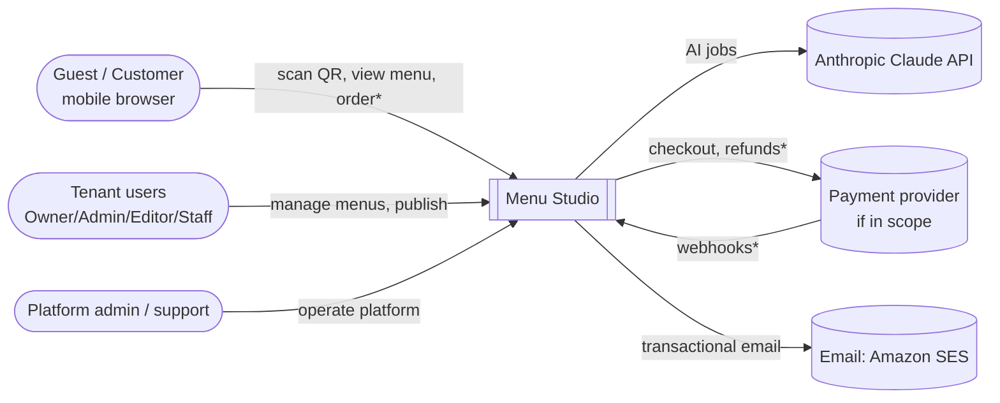
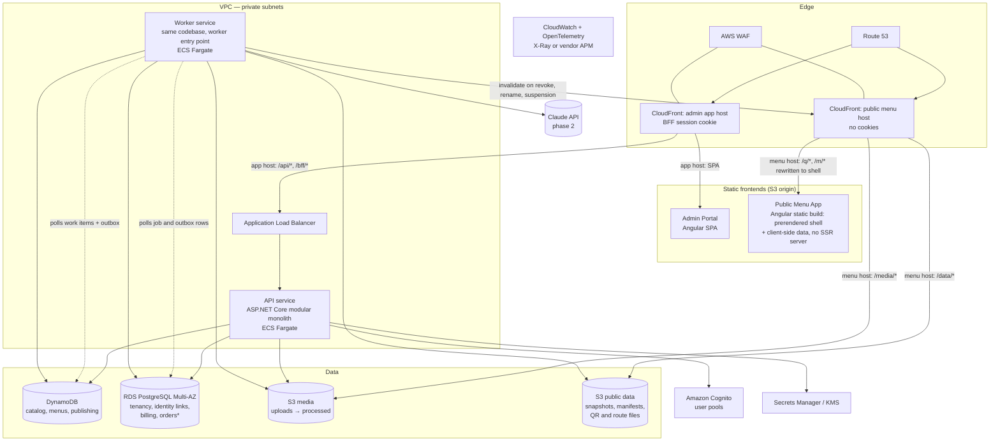
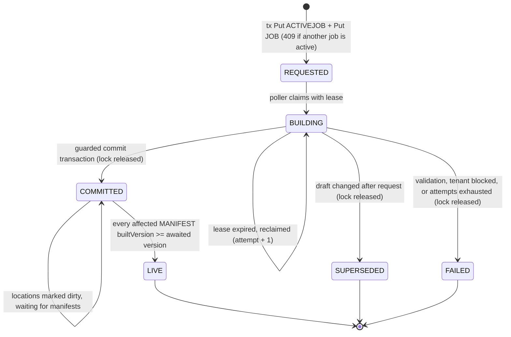

# 04 — High-Level Architecture

Tags: [S] stated · [D] derived · [A] assumption · [R] recommendation
**Revision 0.3 (approved baseline):** two hostnames (§3); work items and outbox instead of SQS/Streams (ADR-18); publish flow rewritten with the per-menu lock, tenant guard, MANIFEST lease, UNPUBLISH, full-state rollback and cache table (§4.1); QR edge check (§4.2); sold-out overlay and AI in phase 2 (§4.3–4.4); region `us-east-1` proposed (§5.1); public-app amendments (§6.2); BFF (§6.5).
Revision 0.2: fully static public path (§3, §4.2); authoritative publication pointer, publish state machine and failure handling (§4.1); public app hosting resolved, static prerendering vs. dynamic SSR (§6.2); .NET 10; production topology vs. learning environment (§5).

---

## 1. Architectural drivers

| Driver | Consequence |
|--------|-------------|
| Customer menu views far outnumber admin edits, and they arrive in meal-time spikes | **Separate the read path from the write path.** Customers read static snapshots from the CDN, not from the API. |
| Multi-tenant, many small tenants | Shared (pooled) infrastructure with logical isolation. Cost per tenant must be near zero when idle. |
| Primarily one developer (Rev 0.2) and a 12-week learning horizon | **Modular monolith**: one deployable, strict internal module boundaries. No microservices. Local-first development. |
| Technology choices given [S] | Angular, ASP.NET Core, DynamoDB, PostgreSQL, S3, Terraform, Claude API. |
| AI calls are slow (seconds) and cost money | AI runs **asynchronously** in a background worker, with quotas. |

## 2. Context (C4 level 1)

\* future; out of MVP-1 (Rev 0.2).

## 3. Containers (C4 level 2)

### 3.1 Container responsibilities

| Container | Responsibility | Tech |
|-----------|---------------|------|
| **Admin Portal** | Tenant back-office: catalogue, menus, locations, publish, QR, users (AI review in phase 2). | Angular (active/LTS major, verified at environment preparation, doc 10 §3), standalone components, signals; static CSR SPA on the **admin app hostname**, signed in through the BFF session. |
| **Public Menu App** | Customer-facing menu (cart/order* later). | Angular **static build**: prerendered app shell + client-side rendering of CDN JSON; runtime UI dictionaries; strict bundle budget; on the **public menu hostname** (no cookies). No SSR server. See §6.2. |
| **API service** | Admin commands/queries and **BFF endpoints** (OIDC login/logout, session). **No public endpoints in MVP-1.** | ASP.NET Core on **.NET 10 LTS** (ADR-01), on ECS Fargate behind ALB, reached via the admin app hostname. |
| **Worker service** | Publish jobs, manifest builds, QR/route projections, reconciler, media processing, outbox dispatch, tenant purge and supervisor (AI jobs in phase 2). | Same solution, separate host (`Worker` entry point) running **pollers over work items** (DynamoDB `WorkIndex`, PostgreSQL `SKIP LOCKED`) with leases. No SQS (ADR-18). |
| **DynamoDB** | Tables `catalog`, `media`, `menus`, `publishing` (`ai` in phase 2). | On-demand, PITR, KMS; `TenantIndex` + sparse `WorkIndex` on every table; **no Streams** in MVP-1. |
| **PostgreSQL** | Tenants, memberships, locations, audit, deletion tracking, outbox (billing, orders*, payments* later). | RDS PostgreSQL (or Aurora PostgreSQL Serverless v2, see §6.4). |
| **S3** | Media (raw + processed); public data projections (snapshots, manifests, QR/route files); app bundles; QR print assets; exports. | Separate buckets; block public access; CloudFront Origin Access Control only; tenant-prefixed keys and versioning (doc 09 §4.4). |
| **Cognito** | Authentication for tenant users and platform staff (separate user pools); Keycloak realms locally. | Used only through the BFF (server-side OIDC code flow + PKCE); MFA for Owner/Admin. |

\* future; out of MVP-1.

## 4. Key runtime flows

### 4.1 Publish flow and the authoritative publication pointer (Rev 0.3 baseline, ADR-10)

#### Single source of truth
The **authoritative record** of what is live is the Publishing table item `T#{t}#M#{m} / CURRENT` (the menu publication pointer). The location index items `T#{t}#L#{l} / PUB#{m}` are part of the same authoritative state and are **only written in the same transaction**. Key design: doc 07 §3.3.

Supporting items (all in the Publishing table):

| Item | Purpose |
|------|---------|
| `T#{t}#M#{m} / ACTIVEJOB` | Per-menu lock: at most one non-terminal PUBLISH, ROLLBACK or UNPUBLISH job per menu (PUB-1, PUB-3) |
| `T#{t}#M#{m} / JOB#{ulid}` | Job record, state machine below |
| `T#{t}#M#{m} / VER#{n}` | Immutable history with the **full published state**: snapshotKey, locationIds, schedule (PUB-7) |
| `T#{t}#L#{l} / MANIFEST` | Per-location projection state: `dirtyVersion`, `builtVersion`, build lease (PUB-5) |
| `T#{t} / TENANTGUARD` | `ACTIVE` or `BLOCKED`; every commit checks it (PUB-8, TI-6) |

Everything public is a **derived projection**, rebuilt from the authoritative state and never read to make decisions:

| Projection | Where | Rebuilt by |
|------------|-------|-----------|
| Location manifest (live menus, schedules, snapshot URLs, tenant/location status) | S3 `data/t/{t}/locations/{l}/manifest.json` | Manifest builder, under the `MANIFEST` lease |
| QR and route files | S3 `data/qr/{code}.json`, `data/routes/{tenantSlug}/{locationSlug}.json` | Projection builder (pending flag on the `QR#`/`ROUTE#` item) |
| "Last published"/"Live" in the admin UI | Menus header `lastPublishedInfo` | `MenuPublicationCommitted` / `MenuLive` events |
| Edge caches | CloudFront | TTLs (cache table below) |

`CURRENT` fields: `status` (LIVE/UNPUBLISHED), `publishNumber`, `snapshotKey`, `checksum`, `sourceDraftVersion`, `liveDraftVersion`, `locationIds`, `schedule`, `publishedAt/By`, `pointerRevision`, `rolledBackTo?`. Location assignment and schedules are part of the draft; changes take effect at the next publish.

#### Job types and state machine
Types: **PUBLISH** (build from the draft), **ROLLBACK** (restore `VER#k`), **UNPUBLISH** (take the menu offline; required before archiving or deleting a live menu).

#### Steps
1. **Request (API).** Checks: tenant active, `menu.publish` permission. For PUBLISH, read `META.draftVersion` through the Menus contract; `409` if it differs from `expectedDraftVersion`. Then `TransactWriteItems`: Put `ACTIVEJOB` (`attribute_not_exists`) + Put `JOB#{ulid}` (REQUESTED, WorkIndex attributes). If `ACTIVEJOB` exists: same type and draftVersion → return its job (idempotent double click); otherwise `409 Publishing in progress`.
2. **Dispatch (poller-only, ADR-18).** Worker pollers query the WorkIndex every 2–5 s for REQUESTED jobs and BUILDING jobs with expired leases. Identical locally and in AWS; no Streams, Pipes or SQS.
3. **Claim.** Conditional update (`status = REQUESTED`, or `BUILDING AND leaseUntil < :now`) → BUILDING, `leaseOwner`, `leaseUntil = now + 5 min`, `attempt + 1`, `expectedRevision` = current `CURRENT.pointerRevision`. Heartbeat extends the lease if work runs past half of it. After 5 attempts → FAILED + alarm.
4. **Build (PUBLISH only).** Read `META.draftVersion` (v1, consistent) → read the menu header and query the whole menu partition (all pages, consistent) → read META again (v2). Every draft write, including header edits, increments META in the same transaction (PUB-4), so v1 = v2 proves a consistent snapshot. If v1 ≠ v2, retry the read (up to 3 times). If v1 ≠ the job's `draftVersion` → **SUPERSEDED**. `BatchGetItem` the referenced catalog items; a missing or archived item, a missing price, an unprocessed image or more than 90 locations → **FAILED** with a validation list. Serialize deterministically (sorted keys) → SHA-256.
5. **Store snapshot.** `PUT data/t/{t}/snapshots/{sha256}.json` with `If-None-Match: *`; `412` = already exists = success. Where conditional writes aren't supported, HEAD + PUT is safe for content-addressed objects (PUB-13).
6. **Commit (one `TransactWriteItems`, Publishing table):**
   1. `ConditionCheck` `TENANTGUARD.status = ACTIVE`
   2. Update `CURRENT` — PUBLISH: new snapshot, locations, schedule, `liveDraftVersion = draftVersion`; ROLLBACK: values from `VER#k`, `liveDraftVersion = VER#k.sourceDraftVersion`, `rolledBackTo = k`; UNPUBLISH: `status = UNPUBLISHED`, `locationIds = []`. Always `publishNumber = n` and `pointerRevision + 1`. Condition: `attribute_not_exists(PK) OR pointerRevision = :expectedRevision`.
   3. Put `VER#{n}` (`attribute_not_exists`) with the full published state (not for UNPUBLISH)
   4. Put/Delete `PUB#{m}` for each location added or removed
   5. Update the job → COMMITTED with `affectedLocations` (condition `status = BUILDING AND leaseOwner = :me`)
   6. Delete `ACTIVEJOB` (condition `jobId = :job`)
   7. Put outbox event `MenuPublicationCommitted`

   That's 7 fixed actions plus changed locations, within DynamoDB's 100-action limit, hence the **90-locations-per-menu** limit. A guard failure → FAILED ("account not active") and the lock is released. The revision condition can't fail under the lock except through a defect: retry once, then FAILED + alarm. SUPERSEDED and FAILED transitions also release the lock in the same write.
7. **Project.** After commit, the worker marks each affected location's `MANIFEST` dirty (`ADD dirtyVersion 1`, `SET dirty = true`, WorkIndex attributes), records `awaitVersions` on the job, and leaves the job COMMITTED. Manifest pollers claim dirty `MANIFEST` items with a **build lease** (one builder per location), read the authoritative state (`Query PUB#` → consistent `BatchGetItem` of `CURRENT`; location and tenant status), write the manifest (`Cache-Control: max-age=30`), then clear: `SET builtVersion = :v, dirty = false REMOVE GSI2PK, GSI2SK` with condition `dirtyVersion = :v AND buildLeaseOwner = :me`. **If the clear fails, the builder re-marks the location dirty**, so a stale write always gets rebuilt (convergence). When every affected location's `builtVersion` ≥ its awaited version, the job becomes **LIVE** and `MenuLive` is emitted. Guests see the change within ~30 s (TTL).

#### Other triggers that mark manifests dirty
- **Suspension, reactivation, deletion scheduling or cancellation:** Publishing sets `TENANTGUARD` (BLOCKED/ACTIVE) and marks all of the tenant's locations dirty. The builder outputs "unavailable" for blocked tenants, and those manifest paths are **invalidated** for fast takedown.
- **Location deactivation:** marks that location dirty → "unavailable". The Menus module removes the location from menu assignments as a draft change; the next publish removes the `PUB#` items.
- **Tenant being deleted:** builders write nothing (doc 07 §7.3).

#### Failure handling

| Failure | Job state | Recovery | Editor sees | Guests see |
|---------|-----------|----------|-------------|------------|
| Second request while a job is active | (rejected) | Same request → existing job; different → 409 | "Publishing in progress" | — |
| Worker crash before claim | REQUESTED | Poller picks it up | "Publishing…" | Previous version |
| Worker crash during build | BUILDING, lease expires | Reclaimed; same draft → same hash | Delay | Previous version |
| Draft edited after the click | SUPERSEDED, lock released | Review and publish again | Message | Previous version |
| Validation error | FAILED, lock released | Fix the draft, publish again (new job) | Error list | Previous version |
| S3 PUT fails | BUILDING | Retry with backoff; 5 attempts → FAILED + alarm | Delay or error | Previous version |
| Tenant blocked during publish | FAILED, lock released | — | "Account not active" | Unavailable or previous |
| Commit transient error | BUILDING | Retry | Delay | Previous version |
| Commit OK, manifest build fails | COMMITTED | `MANIFEST` stays dirty; pollers retry; reconciler alarms after 15 min | "Published, going live…" | **Previous manifest — consistent, never mixed** |
| Builder lease expired mid-write (stale write) | COMMITTED/LIVE | Failed clear re-marks dirty → rebuild | — | ≤ ~30 s stale |
| Retry after FAILED | New job | Lock was released, so publishing again simply works | — | — |

**Reconciler** (every 5 min; alarms, nothing more clever): COMMITTED jobs older than 5 min → re-mark their locations dirty; `MANIFEST` dirty longer than 15 min → alarm; projection-pending `QR#`/`ROUTE#` items older than 5 min → alarm; an `ACTIVEJOB` pointing to a terminal or missing job → release + alarm. Everything it touches is rebuildable from authoritative state, so reconciling is always safe.

**Snapshot cleanup** (daily): keep the last 50 `VER#` per menu (plus anything `CURRENT` references); delete older `VER#` items; delete snapshot objects referenced by no retained `VER#` after a 7-day grace period.

**Cache-control:**

| File | Cache-Control | Invalidated on |
|------|---------------|----------------|
| App assets (hashed) | `max-age=31536000, immutable` | — |
| `index.html` | `no-cache` (revalidate) | Deploy |
| `data/t/{t}/snapshots/{hash}.json` | `max-age=31536000, immutable` | — |
| `manifest.json` | `max-age=30` | Suspension, deletion |
| `data/qr/{code}.json`, `data/routes/…` | `max-age=300` | Revoke, rename, deletion |
| 403/404 on `data/qr/*` | Error caching 60 s | — |

### 4.2 QR and route resolution (static)
1. `/q/{code}` → a **CloudFront Function** checks the code against `^[A-Za-z0-9_-]{22}$`. Malformed codes get `404` at the edge; valid ones are rewritten to the app shell `/index.html`.
2. The app fetches `/data/qr/{code}.json` (TTL 300 s; 403/404 cached 60 s). It contains `tenantId`, `locationId`, slugs, the manifest path, an optional menu, and `status`.
3. The app navigates client-side to `/m/{tenantSlug}/{locationSlug}`, fetches the manifest, then the snapshot.
- Shared links to `/m/...` read `/data/routes/{tenantSlug}/{locationSlug}.json` instead.
- QR and route files are projections of the authoritative `QR#`/`ROUTE#` items (doc 07 §3.3). A revoked code's file is overwritten with `{"status":"revoked"}` only and invalidated.
- Trade-off: three small sequential CDN fetches after the shell. If the performance budget fails, publish-time HTML rendering is the first option (§6.2).
- Code format and rate limiting: doc 07 §3.3.1, doc 09 §4.5–4.6.

### 4.3 Availability overlay — phase 2 (U6)
MVP-1 uses the `soldOut` flag on placements, applied on publish. In phase 2: a small `availability.json` per location (sold-out item IDs) with a ~10–15 s TTL, merged by the public app, giving near-real-time "86'd" updates without republishing.

### 4.4 AI job flow — phase 2 (ADR-08, ADR-15)
Design kept for phase 2. Admin uploads a photo/PDF (stored at `t/{tenantId}/ai-inputs/…`, 30-day lifecycle) → API checks the plan limit and quota → AI job item (WorkIndex) → worker calls Claude with **structured outputs** against a strict JSON schema (forced `tool_choice` isn't supported on the default model), effort set explicitly, `refusal` stop reasons handled → results stored as **suggestions** (`SUG#` items, doc 07 §3.4) → the editor accepts, edits or rejects → accepted content becomes a normal draft change. Allergens are extracted only when printed on the source and flagged "unverified". One concurrent AI job per tenant; size and page limits per job. Every call is metered per tenant (`ai_usage`). Model: `claude-opus-5-5` by default; a cheaper model only after measured evaluation.

## 5. Deployment and environments

### 5.1 Target production topology (phase 2, after the 12-week roadmap)

| Aspect | Recommendation [R] |
|--------|--------------------|
| AWS accounts | AWS Organizations: `management`, `security/log-archive`, `shared-services` (ECR, CI roles), `dev`, `staging`, `prod`. |
| Region | US launch (ADR-17): **`us-east-1`** proposed [R]. CloudFront certificates and the CloudFront-scope WAF must live there anyway; confirm before week 9. Multi-AZ in production. |
| Network | VPC with public subnets (ALB, NAT) and private subnets (ECS, RDS). VPC endpoints for S3, DynamoDB, Secrets Manager, ECR to reduce NAT costs. |
| Compute | ECS Fargate (API: min 2 tasks across AZs; Worker: autoscale on queue depth). |
| CI/CD | GitHub Actions (assumed; confirm) using OIDC to assume AWS roles, no static keys. Build → test → container image to ECR → Terraform plan/apply → ECS rolling/blue-green deploy. |
| Terraform | Remote state in S3 with native S3 state locking (DynamoDB lock table is no longer needed on current Terraform versions); one state per environment per stack (`network`, `data`, `compute`, `edge`); shared modules. |
| DB migrations | EF Core migrations run as a one-off ECS task before deploy; expand/contract pattern. |
| Observability | OpenTelemetry SDK in .NET → CloudWatch / X-Ray (or a vendor). Dashboards per module; alarms on p95 latency, 5xx, DLQ depth, publish failures, AI spend. |

### 5.2 Development path (Rev 0.2, ADR-16)

| Stage | Weeks | Environment |
|-------|-------|-------------|
| Local | 1–8 | Docker: PostgreSQL, DynamoDB Local, LocalStack (S3), Keycloak (OIDC), Mailpit. Same work-item pollers as in AWS (ADR-18). Details: doc 10 §4, §12. |
| One AWS account | 9–12 | Same architecture as §3 with cost reductions: one environment, single-AZ RDS, Fargate in public subnets with tight security groups and no NAT Gateway, free gateway endpoints for S3/DynamoDB, budget alarms. **These are deliberate deviations from §5.1.** |
| Production | Phase 2 | §5.1 topology. |

## 6. Key trade-offs

### 6.1 Modular monolith vs. microservices
**Choose the modular monolith.** Microservices would add distributed transactions, service discovery and N deploy pipelines to a product that has neither the team size nor proven scale to justify them. The modules are designed so that the most likely candidates to split out later (Public read, Ordering, AI worker) can be extracted.

### 6.2 Public application hosting (resolved in Rev 0.2, ADR-05)

**Rendering modes compared:**

| Mode | What happens | Fit for Menu Studio |
|------|-------------|---------------------|
| **Static prerendering (SSG)** | HTML generated **at build time** for routes known at build time | Only for the **app shell** and fixed pages (not found, unavailable, about). Tenant menus are runtime data that changes on every publish, so they can't be prerendered at build time without rebuilding and redeploying the app per publish. |
| **Dynamic SSR** | A Node.js server renders HTML **for every request** (cacheable at the CDN) | Faster first paint and SEO, but it adds a Node runtime beside .NET, puts compute in the public path (contradicting ADR-04), and adds cost and operations work. |
| **Client-side rendering (CSR)** | The browser renders from JSON | Works with static hosting; content appears after the JS and JSON load. |
| **Publish-time rendering** (future option) | The worker renders HTML per menu at publish time and writes it to S3 | Static hosting, fast first paint and SEO, but needs a rendering pipeline and regeneration of all pages on every app release. |

**Decision (MVP-1):** an Angular **static build** (static output mode, no server bundle), producing a **prerendered app shell** plus **CSR** of the CDN JSON (manifest, snapshot). **No SSR server.**
- Hosting: S3 bucket for the app plus CloudFront. A **CloudFront Function** rewrites `/q/*` and `/m/*` to `/index.html`. Hashed assets are cached as immutable; `index.html` has a short TTL with revalidation.
- **Don't** use distribution-wide 403/404 → `index.html` custom error responses. They would turn missing data files into HTML `200` responses and hide real errors.
- Shell requirements: inline critical CSS, skeleton UI, zoneless change detection, no heavy UI component library, strict bundle budgets enforced in CI, all text from JSON (no tenant data in the shell).
- The admin portal is also a static CSR SPA (it needs no SEO), on its own hostname (X-5).
- **Rev 0.3 amendments (ADR-05):** guest UI labels come from **runtime JSON dictionaries** loaded with the shell (Angular's compile-time i18n would need one build per locale); a supported-browser matrix that includes **in-app browsers** opened from camera and messaging apps; an architecture lint rule forbidding imports from admin libraries or large UI kits in the public project.
- Verify the exact Angular configuration names (output mode, per-route render modes) for the Angular version chosen at environment preparation (doc 10 §3).
- **Revisit trigger:** if the reference low-end device fails NFR-PERF-01 in week 6, or SEO/link previews become a requirement → evaluate publish-time rendering first (it keeps static hosting); consider dynamic SSR last.

### 6.3 ECS Fargate vs. Lambda for the API
- Fargate: steady cost (~2 tasks always running), no cold starts, simple long-lived connections (SSE/WebSockets for order board), standard ASP.NET hosting.
- Lambda: scales to zero, but cold starts for .NET, connection management to PostgreSQL (needs RDS Proxy), and awkward for real-time order streams.
- **Choose Fargate for API and worker.** Lambda is fine for small event handlers (e.g., S3 image-processing trigger) if preferred.

### 6.4 RDS PostgreSQL vs. Aurora Serverless v2
- MVP-1 has no orders, so PostgreSQL load is tiny → **RDS PostgreSQL on a small Graviton instance**: single-AZ in the learning environment, Multi-AZ in production.
- If ordering is in scope with spiky load → Aurora Serverless v2 is worth evaluating.

### 6.5 Cognito vs. self-hosted identity (e.g., ASP.NET Identity / Duende / Keycloak)
- Cognito: managed, cheap at low volume, MFA built in. Customizing its UX is limited and migrating away from it later is hard.
- **Recommend Cognito** for v1, unless enterprise SSO (SAML/OIDC per tenant) is a near-term requirement. In that case evaluate alternatives early (doc 11, U9). Locally, Keycloak stands in as the OIDC provider (ADR-06).
- **Decided (Rev 0.3): BFF cookie session.** ASP.NET Core performs the OIDC code flow server-side and issues an HttpOnly, Secure, SameSite=Strict cookie on the admin hostname; the SPA never holds tokens. The app reads only `iss` + `sub`; identities are stored provider-neutrally (`idp_issuer`, `idp_subject`).

### 6.6 Real-time for orders (future; out of MVP-1)
Server-Sent Events from ASP.NET for the staff board (simple, works through ALB), with a Redis-free fan-out at first: one API instance per connection, polling PostgreSQL `LISTEN/NOTIFY` or a short-interval query. Revisit with ElastiCache or API Gateway WebSockets if connections grow beyond a few thousand.
