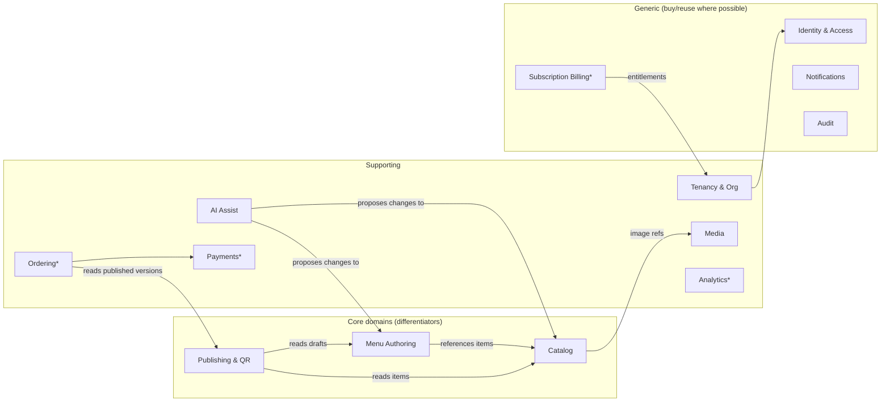

# 05 — Domain Boundaries and Modular Monolith Design

Tags: [S] stated · [D] derived · [A] assumption · [R] recommendation
**Revision 0.3 (DRAFT, pending approval — doc 13):** Media gets its own table (X-1); integration events and background jobs via transactional outbox relay to Amazon SQS, no Streams (ADR-18, accepted 2026-11-21); `MenuPublicationCommitted`/`MenuLive` events; AI Assist in phase 2.
Revision 0.2: Catalog/Menu split accepted (ADR-07); Publishing owns the authoritative publication pointer and public projections; Tenancy orchestrates tenant deletion; new and changed integration events; ordering/payments not built in MVP-1.

---

## 1. Bounded contexts


\* not in MVP-1. Ordering and online payments are out by decision (ADR-12); billing and analytics are deferred in the roadmap.

| Module | Owns (data + rules) | Store | Ubiquitous language |
|--------|---------------------|-------|---------------------|
| **Identity & Access** | User ↔ Cognito link, memberships, roles, permissions, location scopes, API keys | PostgreSQL | user, membership, role, permission |
| **Tenancy & Org** | Tenant, business profile, **multiple locations per tenant** (ADR-13), settings (currency, timezone, languages), lifecycle (active/suspended/pending_deletion/deleted), feature flags, **tenant deletion orchestration** (doc 07 §7) | PostgreSQL | tenant, location/outlet, settings |
| **Catalog** | Items, variants, modifier groups, allergens/dietary tags, translations | DynamoDB `catalog` table | item, variant, modifier, allergen |
| **Menu Authoring** | Menus, sections, item placements and overrides, schedules, location assignment, draft versioning, sold-out state | DynamoDB `menus` table | menu, section, placement, draft |
| **Publishing & QR** | **Authoritative publication pointer** per menu, publish jobs, published versions, snapshot build, QR codes and routes (authoritative items), **public projections** (location manifests, QR/route files), reconciler, CDN invalidation | DynamoDB `publishing` table (authoritative) + S3 (projections) | publication pointer, version, snapshot, manifest, route, QR code |
| **Media** | Upload sessions, image metadata, processing pipeline (SQS `media` queue), quotas | DynamoDB `media` table (Rev 0.3, X-1) + S3 | asset, rendition |
| **AI Assist** (phase 2) | AI jobs, suggestions, prompt templates & versions, usage metering | DynamoDB `ai` table + PostgreSQL (`ai_usage` ledger) | job, suggestion, acceptance |
| **Ordering*** | Carts (server-side validation), orders, order lines, status workflow | PostgreSQL | order, line, ticket |
| **Payments*** | Payment intents, captures, refunds, PSP webhooks, ledger | PostgreSQL | payment, refund, ledger entry |
| **Subscription Billing*** | Plans, subscriptions, entitlements, invoices (mirrored from PSP) | PostgreSQL | plan, subscription, entitlement |
| **Notifications** | Email templates, sending, preferences | — (SES) | notification |
| **Audit** | Append-only audit trail for security-relevant actions | PostgreSQL (partitioned) + S3 archive | audit event |
| **Analytics*** | Scan counts, item views | CloudFront logs → S3 → Athena (no OLTP store) | scan, view |

### Why Catalog and Menu Authoring are separate modules (ADR-07, accepted in Rev 0.2)
Rev 0.2 names Catalog, Menu Authoring and Publishing as the DynamoDB domains, so the split is kept. **Catalog** owns *what is sold* (items, modifiers, allergens, dietary tags). **Menu Authoring** owns *how it is presented* (menus, sections, placements, schedules, location assignment). Retail inventory is out of the first release (ADR-14), so Catalog stays food-focused. Items are reused across menus with per-menu overrides (U3, Rev 0.3), which is exactly the catalog + placement split.

## 2. Solution structure [R]

```
src/backend/
  MenuX.sln
  src/
    Host.Api/                     # ASP.NET Core host: composition root, auth, middleware
    Host.Worker/                  # Worker host: SQS consumers, outbox relay, reconciler, schedulers
    BuildingBlocks/
      MenuX.SharedKernel/    # TenantId, Money, Result, domain event base — tiny, stable
      MenuX.Infrastructure/  # Outbox + relay, SQS messaging, DynamoItemWriter, EF base, tenant context
    Modules/
      Tenancy/
        Tenancy.Contracts/        # Public API of the module: commands, queries, integration events, DTOs
        Tenancy.Application/      # use cases (handlers)
        Tenancy.Domain/           # aggregates, invariants
        Tenancy.Infrastructure/   # EF DbContext (schema "tenancy"), repositories
        Tenancy.Endpoints/        # HTTP endpoints for this module
      Identity/ ...
      Catalog/  ...               # Infrastructure uses DynamoDB
      Menus/    ...
      Publishing/ ...
      Media/ ...
      AiAssist/ ...
      Ordering/ ...               # not created in MVP-1 (ADR-12)
      Billing/ ...
  tests/
    ArchitectureTests/            # NetArchTest/ArchUnitNET: enforce boundaries
    <Module>.UnitTests / IntegrationTests (Testcontainers: PostgreSQL, LocalStack/DynamoDB Local)
```

For a small team, collapsing each module's `Application/Domain/Infrastructure` into one project with folders is fine. **What matters is the `Contracts` project boundary**, not the number of projects.

## 3. Module rules (enforced by architecture tests) [R]

1. A module can reference **only another module's `.Contracts`** project, never its internals.
2. **Each module owns its data.** No module reads or writes another module's tables or DynamoDB items. Each PostgreSQL module has its own **schema** (`tenancy`, `identity`, `billing`, `ordering`, `payments`, `audit`) and its own `DbContext`. Each DynamoDB module has its **own table**.
3. Communication between modules:
   - **Synchronous query** through the Contracts interface (in-process call), e.g., `IMenuReadApi.GetPublishedVersion(...)`.
   - **Asynchronous integration events** through a transactional **outbox** (a PostgreSQL outbox table or DynamoDB `OUTBOX` items written in the same transaction), sent by the outbox relay to the SQS `events` queue and delivered to in-process handlers (ADR-18; SNS later for fan-out; no Streams in MVP-1), e.g., `MenuPublicationCommitted`, `TenantSuspended`, `ItemArchived`.
4. No distributed transactions across modules. Consistency across modules is **eventual**, using idempotent handlers.
5. `SharedKernel` contains only value types used everywhere (`TenantId`, `Money`, `LanguageCode`). No business logic.
6. Tenant context (`ITenantContext`) comes from the request and is never taken from the payload.

## 4. Key integration events

| Event | Producer | Consumers | Purpose |
|-------|----------|-----------|---------|
| `TenantCreated` | Tenancy | Billing, Catalog, Menus | Initialize defaults, trial |
| `TenantSuspended` / `TenantReactivated` | Tenancy/Billing | Publishing | Take public menus offline / back online |
| `TenantDeletionRequested` | Tenancy | **All modules** (via per-module rows in `tenancy.tenant_deletion_module_status`) | Each module purges its own data via TenantIndex and S3 prefixes (doc 07 §7) |
| `TenantDataPurged` | Each module (status row → `done`) | Tenancy supervisor | Tenant marked `deleted` when all modules are done |
| `LocationCreated/Renamed/Deactivated` | Tenancy | Publishing | Route items and projections; manifest rebuild |
| `ItemChanged` / `ItemArchived` | Catalog | Menus (mark affected menus "has unpublished changes") | Draft awareness |
| `MenuPublicationCommitted` | Publishing (outbox item written in the commit transaction) | Menus (set `hasUnpublishedChanges = (draftVersion ≠ liveDraftVersion)`, update `lastPublishedInfo`); Ordering*, Analytics* later | Fires at commit, before guests can see the change (PUB-11) |
| `MenuLive` | Publishing (when every affected location's manifest is rebuilt) | Notifications, admin UI | "Live" status for the editor |
| `TenantDeletionScheduled` / `TenantDeletionCanceled` | Tenancy | Publishing (tenant guard BLOCKED/ACTIVE, manifests unavailable/rebuilt) | Grace-period behaviour |
| `PublishFailed` / `PublishSuperseded` | Publishing | Notifications, admin UI | Tell the editor |
| `AiSuggestionAccepted` | AI Assist | Catalog / Menus (as commands, not events) | Apply change |
| `SubscriptionChanged` | Billing | Tenancy (entitlements) | Limits/feature flags |
| `OrderPlaced`, `OrderStatusChanged`* | Ordering | Notifications, Analytics | |
| `PaymentSucceeded/Failed/Refunded`* | Payments | Ordering | |

## 5. Data flow between DynamoDB and PostgreSQL modules
The only cross-store dependencies are **references by ID** plus **snapshots**:
- Catalog/Menus store `tenantId` and `locationId` (owned by Tenancy, in PostgreSQL). Validated at write time through `ITenancyReadApi`, cached in memory.
- Ordering stores `menuVersionId` plus a **copy** of item name/price/modifiers on each order line. It never joins live catalogue data.
- No foreign keys cross stores. Deletion is coordinated through `TenantDeletionRequested`.

## 6. Future extraction candidates
| Module | Trigger to extract |
|--------|-------------------|
| Public read / QR resolver | Already effectively extracted (CDN + S3); resolver could move to CloudFront Functions/Lambda@Edge. |
| AI Assist worker | Different scaling and cost profile; separate deployment if job volume grows. |
| Ordering | Higher availability needs than admin; separate team. |
