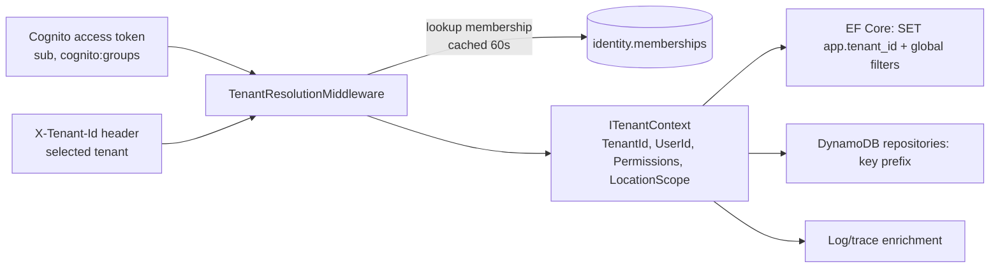

# 09 — Security and Multi-Tenancy Strategy

Tags: [S] stated · [D] derived · [A] assumption · [R] recommendation
**Revision 0.3 (DRAFT, pending approval — doc 13):** US pilot / UAE launch privacy tracks and `me-central-1` (draft 2026-11-21); background jobs on SQS via outbox relay (§2, ADR-18 accepted 2026-11-21); BFF decided (§3); S3 tenant-prefixed layout and version purge (§4.4); QR edge check, WAF in `us-east-1`, alarm-only miss detection (§4.6); AI constraints in phase 2 (§6); US privacy (§8).
Revision 0.2: no public API in MVP-1 (§2); local OIDC (§3); purge role and TenantIndex access (§4.3); QR identifiers (§4.5) and rate limiting (§4.6) added; enumeration threat (§9).

---

## 1. Tenancy model

| Model | Description | Verdict |
|-------|-------------|---------|
| Silo | Database/account per tenant | Too costly and complex for many small cafes. Possible later as a premium "enterprise isolation" tier. |
| Bridge | Schema per tenant | Migrations across thousands of schemas are painful; doesn't apply to DynamoDB. |
| **Pool** | Shared tables, `tenant_id` on every row/key | **Chosen.** Cheapest and simplest to operate. Needs isolation enforced at several layers. |

Design for a later **"tenant tier"** attribute (e.g., `pooled` / `dedicated`), so a large hotel group could get dedicated resources without forking the code.

## 2. Tenant context: the single source of truth



Rules:
1. Tenant ID comes from **the authenticated user's verified membership**. Because one user can belong to several tenants, the client sends the *selected* tenant (header). The server **verifies membership** on every request. It never trusts a `tenantId` in a body or route without that check.
2. Resolved once per request into a scoped `ITenantContext`. Handlers can't set it.
3. SQS job messages and outbox events carry `tenantId`. The worker re-establishes `ITenantContext` and **checks tenant status before every write**; messages for non-active tenants are acknowledged and dropped. Queues are encrypted (SSE), private to the account, and only the application's IAM roles can send or receive (ADR-18).
4. **Public access has no tenant context.** In MVP-1 the public path is fully static (CloudFront + S3 projections, ADR-04/05), so **there are no public API endpoints**. Any public endpoint added later (e.g., ordering) must be a separate endpoint group with its own authorization and rate-limit policies.

Alternative considered: putting `tenant_id` as a custom claim in the token (Cognito pre-token-generation Lambda). It's faster, but switching tenant requires a token refresh and membership revocation lags until token expiry. **Recommend the header + server-side membership check**, with a short cache.

## 3. Authentication

| Population | Mechanism |
|------------|-----------|
| Tenant users | Cognito user pool #1. Email+password with **MFA required for Owner/Admin** (TOTP or passkeys/WebAuthn); optional for others [A]. OAuth2 Authorization Code + PKCE performed **server-side by the BFF** (Rev 0.3); the browser holds only the session cookie. |
| Platform staff | Cognito user pool #2 (or federated from the company IdP via SAML/OIDC). MFA mandatory. Separate admin app hostname. |
| Guests | Anonymous. If ordering: a per-order `guest_token` (random, 128-bit, stored hashed), carried in the order-status URL. |
| Machine (PSP webhooks) | Provider signature verification (e.g., HMAC with timestamp tolerance) + idempotency on event ID. |
| Service-to-AWS | IAM task roles (ECS), no static keys. |
| Local development (Rev 0.2) | A Keycloak container acts as the OIDC provider, with test realms (users in two tenants, every role). The API validates standard OIDC/JWT only, so switching to Cognito is configuration (doc 10). Keycloak is never deployed. |
| Enterprise SSO per tenant [A] | Cognito supports SAML/OIDC IdPs per user pool. Per-tenant IdPs at scale is awkward → revisit if required. |

Token handling for the SPA [R]: short-lived access tokens (≤ 15 min), refresh token rotation. Prefer a **Backend-for-Frontend (BFF)** cookie session (HttpOnly, Secure, SameSite=Strict) over storing tokens in browser storage. This removes token theft through XSS. The trade-off is a small amount of BFF code in the ASP.NET host. **Proposed (Rev 0.3 draft, pending approval): BFF.** The cookie is scoped to the admin hostname; the public hostname sets no cookies (X-5).

[D] **Tenant resolution and API pipeline (week 2 slice 3, 2026-11-23):**
- First login: email, `email_verified` and name are read from the ID token once (`email profile` scopes) to create the MenuX user; unverified emails create no user and the login returns `/?loginError=email_not_verified`. The identity provider also enforces verification (local realm: `verifyEmail`).
- Every `/api` request: user from `iss` + `sub` (`identity.find_user_id`), selected tenant from `X-Tenant-Id`, verified active membership with permissions and location scope (cached 60 s); unknown or foreign tenants → **404**. Without `X-Tenant-Id`, only the user's own data and a read-only list of their member tenants (`app.member_tenant_ids`).
- Writes: anti-forgery token → tenant-status gate (`suspended`, `pending_deletion`, `deleting` are read-only) → billing access policy (`ITenantAccessPolicy`, allow-all until billing rules exist).
- One PostgreSQL transaction per request shared by all module contexts (`PostgresUnitOfWork`), committed only when the endpoint succeeds; tenant creation uses its own unit of work for the new tenant.
- Permissions checked per endpoint (`RequirePermission`), never role names; new permission `tenant.manage` (Owner, Admin). Owner role changes need the owner-only `tenant.delete` permission; a tenant always keeps one active owner.
- `ITenantContextSetter` is only used by the middleware and tenant onboarding (architecture test). Cross-tenant harness covers every `/api` endpoint automatically.

[D] **BFF implementation notes (week 2, 2026-11-22):**
- Endpoints: `GET /bff/login?returnUrl=` (local paths only; no open redirect), `GET /bff/session` (200 with the session and a fresh anti-forgery token, or **401**, never a redirect), `POST /bff/logout` (anti-forgery token required; ends the local and the identity-provider session).
- The OIDC code flow runs server-side with PKCE; ASP.NET Core automatically uses **Pushed Authorization Requests (PAR)** when the provider supports them (Keycloak does), so the authorize parameters never appear in the browser URL.
- The session cookie `__Host-menux-session` (HttpOnly, Secure, SameSite=Strict, 8 h sliding) holds only `iss` and `sub`; no tokens are saved. The default `iss` claim deletion of the OIDC handler is disabled so `idp_issuer` is available.
- Anti-forgery: `__Host-menux-antiforgery` cookie plus a readable `__Host-XSRF-TOKEN` cookie whose value the SPA sends in `X-XSRF-TOKEN`.
- Local Keycloak realm `menux` (`infrastructure/local/keycloak/menux-realm.json`): client `menux-admin-bff`, synthetic users `owner.a`, `admin.a`, `editor.a`, `staff.a`, `owner.b`, `editor.b`, `multi` @example.test (password `local-dev-only`); tenant memberships live in the MenuX database, not in Keycloak.
- Tested end to end against a Keycloak container (`BffLoginTests`).

## 4. Authorization and data isolation (defense in depth)

| Layer | Control |
|-------|---------|
| **L1 Edge** | WAF managed rules (OWASP core, known bad inputs, IP reputation), rate limiting per IP, geo rules if needed. |
| **L2 API** | ASP.NET authorization policies per **permission** (`[RequirePermission("menu.publish")]`), plus location scope checks. Default policy = authenticated + tenant resolved. Public endpoints opt out explicitly. |
| **L3 Application** | Repositories require `ITenantContext`; EF Core global query filters on `TenantId`; DynamoDB key builders always prefix `T#{tenantId}`. **Architecture tests** fail the build if a repository method takes a tenant ID parameter from callers. |
| **L4 Database — PostgreSQL** | **Row-Level Security** (below). |
| **L4 Database — DynamoDB** | IAM fine-grained access with `dynamodb:LeadingKeys` (below). |
| **L5 Storage — S3** | Object keys prefixed `t/{tenantId}/`; uploads through **presigned URLs** generated server-side for a specific key, content type and max size. |
| **L6 Verification** | Automated **cross-tenant tests** in CI: tenant A tries to read/write tenant B's resources on every endpoint and must get 404 (not 403, to avoid revealing that the resource exists). |

### 4.1 Insecure direct object reference (IDOR) protection
Return **404** for resources outside the tenant. IDs are UUIDv7/ULID, but **unguessable IDs are not a security control**. Authorization is always checked.

### 4.2 PostgreSQL Row-Level Security
```sql
ALTER TABLE ordering.orders ENABLE ROW LEVEL SECURITY;
ALTER TABLE ordering.orders FORCE ROW LEVEL SECURITY;
CREATE POLICY tenant_isolation ON ordering.orders
  USING (tenant_id = current_setting('app.tenant_id', true)::uuid)
  WITH CHECK (tenant_id = current_setting('app.tenant_id', true)::uuid);
```
- The app connects as a role that **does not own** the tables and **does not have BYPASSRLS**.
- Each unit of work runs `SET LOCAL app.tenant_id = '...'` inside the transaction, through an EF Core `DbConnectionInterceptor`/transaction interceptor. `SET LOCAL` is essential with connection pooling, otherwise a pooled connection could carry the previous tenant.
- If `app.tenant_id` isn't set, `current_setting(..., true)` returns NULL → **no rows**, so the failure mode is safe.
- Platform/cross-tenant jobs (billing runs, reporting) use a separate role with BYPASSRLS, used only by specific worker jobs, and audited.
- Migrations run as the owner role in a separate deployment step.
- [D] Implementation notes (week 2, 2026-11-22):
  - **Roles:** `menux_owner` (schemas, migrations), `menux_app` (no BYPASSRLS, owns nothing), `menux_platform` (BYPASSRLS, platform jobs only), `menux_rls_definer` (NOLOGIN, BYPASSRLS; owns narrow `SECURITY DEFINER` functions such as the sign-in lookup `identity.find_user_id`, because forced RLS also applies to the schema owner). The app role is a member of none of them (tested).
  - **Every EF Core context uses a transaction:** `TenantScopedDbContext` sets `AutoTransactionBehavior.Always`, because EF Core skips the transaction for single-statement `SaveChanges`, and `SET LOCAL` would then not apply. `TransactionRequiredInterceptor` rejects any command outside a transaction, so a missing transaction fails loudly instead of silently returning no rows; reads use `InTenantTransactionAsync`.
  - **Second setting `app.user_id`:** lets a signed-in user list their own memberships (tenant picker) before a tenant is selected, without a privileged role.

### 4.3 DynamoDB fine-grained access
- The API task role has **no blanket DynamoDB access to tenant tables** (target state). For tenant-scoped requests, the repository layer uses credentials scoped down with an **STS session policy**:
  ```json
  { "Condition": { "ForAllValues:StringLike": { "dynamodb:LeadingKeys": ["T#<tenantId>", "T#<tenantId>#*"] } } }
  ```
- Trade-off: `AssumeRole` per tenant adds latency/complexity. Cache scoped credentials per tenant for their lifetime (e.g., 15 min). **MVP option:** start with L3 application enforcement plus cross-tenant tests, and add LeadingKeys session policies as a **required gate before onboarding any real pilot tenant** (draft; doc 11 T1, doc 10 §12.5).
- The patterns must match exactly `T#<tenantId>` or `T#<tenantId>#*` (separator boundary included; corrected in Rev 0.2).
- Items whose partition key doesn't start with the tenant (`QR#`, `ROUTE#`) are written and read only by the Publishing module's role and projection builder.
- The **TenantIndex** GSI (doc 07 §7) can be queried only by the dedicated **purge/export worker role**. The API role has no permission on it. Purge runs are audited.

### 4.4 S3 (Rev 0.3: tenant-prefixed layout, X-3 / TI-11)
- All buckets: Block Public Access, SSE-KMS (media/public data) or SSE-S3, **versioning**, TLS-only bucket policy, lifecycle rule expiring non-current versions.
- Read access only through CloudFront **Origin Access Control**.
- **Key layout (tenant prefix first, so purge by prefix is complete):**

| Bucket | Keys |
|--------|------|
| Media | `t/{tenantId}/uploads/{assetId}` (private) · `t/{tenantId}/processed/{assetId}/{size}.webp` (served) · `t/{tenantId}/qr-assets/…` · `t/{tenantId}/ai-inputs/…` (phase 2, 30-day lifecycle) |
| Public data | `data/t/{tenantId}/snapshots/…`, `data/t/{tenantId}/locations/…` · `data/qr/{code}.json`, `data/routes/{tenantSlug}/{locationSlug}.json` (outside the tenant prefix; deleted by key list, doc 07 §7.3) |
| Exports | `t/{tenantId}/exports/…` (deleted after 7 days) |

- Media: presigned upload to `uploads/` for a specific key, content type and maximum size. The worker validates (magic bytes, dimensions, size), strips EXIF and writes **WebP** renditions to `processed/`. Only processed renditions are served. Malware scanning: Amazon GuardDuty Malware Protection for S3 (optional, cost).
- Draft images aren't listable; rendition URLs contain unguessable asset IDs. If draft media must be private before publish, use CloudFront signed URLs for the admin preview.
- QR and route projection files contain only routing data. A revoked code's file contains only `{"status":"revoked"}`.
- Tenant purge deletes **all object versions and delete markers** under the tenant prefixes (doc 07 §7.3).

### 4.5 QR identifiers (ADR-11)
- **128 random bits**, base64url, 22 characters, from a cryptographically secure generator (requirement ≥ 96 bits). Format: doc 07 §3.3.1.
- Purpose: guessing valid codes must be infeasible, so venues not yet launched and other codes can't be discovered. At 128 bits, even billions of guesses per second find nothing in practice.
- Codes are public identifiers printed on tables, **not secrets**. Anything a code unlocks beyond the public menu (e.g., future ordering) needs its own controls.

### 4.6 Rate limiting and enumeration detection (Rev 0.3)

| Surface | Control | Initial setting (tune with real traffic) |
|---------|---------|------------------------------------------|
| Malformed QR codes | **CloudFront Function** returns 404 at the edge unless the code matches `^[A-Za-z0-9_-]{22}$` | Free; never reaches S3 |
| Public paths `/q/*`, `/m/*`, `/data/*` | AWS WAF **rate-based rule per client IP** | Generous, e.g., about 1,000 requests per 5 minutes per IP, then a temporary block (shared venue Wi-Fi and carrier NAT) |
| QR guessing (`/data/qr/*` misses) | CloudFront standard logs → scheduled query/metric of 403/404 per IP → **alarm** (MVP-1). Manual block via a WAF IP set. **Automatic blocking: phase 2.** | e.g., > 50 misses per 5 minutes from one IP |
| Origin load from misses | CloudFront caches 403/404 for `/data/qr/*` (S3 without list permission returns 403 for missing objects) | 60 s |
| Admin API | ASP.NET Core rate limiter per user and per tenant (token bucket); `429` + `Retry-After` | Stricter for QR creation (e.g., 100/hour/tenant) and publish (one active job per menu by design) |
| Sign-up and login | WAF rate rule + AWS WAF CAPTCHA/challenge on sign-up; identity provider limits | — |
| Background work | Consumer concurrency limits per queue; per-tenant fairness; DLQ after 5 failed receives, 14-day retention | — |

- **WAF for CloudFront is a global-scope web ACL that must be created in `us-east-1`**, whatever the application region (Terraform note).
- The ASP.NET Core rate limiter is **in-memory per instance**. With several API tasks the effective limit is per task × task count. That's acceptable for MVP-1; exact global limits would need a shared store.

## 5. Application security baseline
| Area | Control |
|------|---------|
| Standard | OWASP ASVS 4.x Level 2; OWASP Top 10 coverage in code review checklist. |
| Input | Validate all commands (FluentValidation or similar); size limits on bodies; rich text **not allowed** in menu descriptions, or sanitized server-side (stored XSS on public menus is a top risk). |
| Output | Angular's default escaping; strict **Content-Security-Policy** on both apps (no inline scripts; nonces for SSR), `X-Content-Type-Options`, `Referrer-Policy`, HSTS. |
| CSRF | BFF cookies (decided): SameSite=Strict + anti-forgery token on state-changing requests; cookie scoped to the admin hostname. |
| Rate limiting | See §4.6. |
| Secrets | AWS Secrets Manager (DB credentials with rotation, PSP keys, Claude API key); never in images or Terraform state in plain text (mark `sensitive`, use `aws_secretsmanager_secret` with values set outside Terraform, or ephemeral resources). |
| Encryption | TLS 1.2+ everywhere; KMS CMKs per data class; RDS encryption; DynamoDB CMK. |
| Dependencies | Dependabot/Renovate; `dotnet list package --vulnerable` and `npm audit` in CI; container image scanning (ECR/Inspector); SBOM. |
| Supply chain | Pin GitHub Actions by SHA; OIDC to AWS; signed images (optional). |
| Logging | No PII or secrets in logs; tenant ID + correlation ID on every line; security events → audit table. |
| Detection | GuardDuty, Security Hub (CIS/AWS FSBP), CloudTrail organization trail to log-archive account, Config rules. |

## 6. AI-specific security [R] — applies in phase 2 (ADR-08, ADR-15)

Rev 0.3 constraints: uploaded sources at `t/{tenantId}/ai-inputs/…` with a 30-day lifecycle; allergens extracted only when printed and flagged "unverified"; JSON via structured outputs; `refusal` stop reasons handled; effort set explicitly; one concurrent AI job per tenant; size and page limits per job.
| Risk | Control |
|------|---------|
| **Prompt injection** from tenant content (e.g., a menu PDF containing "ignore instructions…") | AI outputs are **data only**: structured outputs against a strict JSON schema; the model has **no tools that act on the system**; results always go through human review. |
| Cross-tenant leakage through AI | One tenant per AI request; never batch several tenants' content into one prompt; prompt caching only of tenant-agnostic system prompts. |
| Cost abuse | Per-tenant quotas (entitlements), per-user rate limits, max input size (pages/MB), global spend alarm. |
| Harmful/incorrect allergen output | Allergen suggestions flagged as "unverified" until a person confirms them; UI states this clearly. |
| Data processing | Anthropic as sub-processor in DPA; check data-retention settings of the API account; no customer (guest) personal data sent to AI. |
| Model refusals/errors | Handle `refusal` stop reason and failures gracefully; job marked failed with a user-readable message. |

## 7. Payment security (future; online payments are out of MVP-1, ADR-12) [A]
- **Hosted checkout / payment elements from the PSP**: card data never touches our servers → target PCI DSS **SAQ A**.
- Server-side price calculation; client totals are ignored.
- Webhooks: verify signature, enforce idempotency, process asynchronously, reconcile daily against PSP reports.
- Refunds require `order.refund` permission + audit event; optional second approval above a threshold.

## 8. Privacy
- Public menu: no cookies, no personal data. Scan analytics come from CDN logs with **IP truncated** before storage.
- Tenant users: email, name. Guests (if ordering): name/phone optional, minimized, retention-limited.
- Data subject requests: export and delete per user; tenant-level export (menus as JSON/CSV).
- Markets (draft, ADR-17/19): **US pilot, then UAE commercial launch.** Data stored in **`me-central-1`** if confirmed by the region decision before the pilot environment (ADR-17, Proposed; week-1 feasibility check only); US pilot users are told their data is stored in the UAE. Two legal tracks: **US pilot** (pilot terms, privacy notice, state-law applicability) and **UAE launch** (Federal Decree-Law 45/2021 PDPL and its executive regulations; DIFC/ADGM rules if the company is set up there; cross-border transfers to sub-processors; Arabic notices). A sub-processor register records where each one processes data.

## 9. Threat model summary (STRIDE, top items)
| Threat | Example | Mitigation |
|--------|---------|-----------|
| Spoofing | Forged webhook | Signature verification |
| Tampering | Client changes price in order | Server-side recalculation from published version |
| Repudiation | "I didn't publish that" | Audit events with actor, IP, correlation ID |
| Information disclosure | Tenant A reads Tenant B's menu drafts | Layered isolation (§4), cross-tenant CI tests |
| Information disclosure | Guessing QR codes to discover venues or table codes | 128-bit random codes; WAF rate rules; miss-rate detection and blocking (§4.5–4.6) |
| Information disclosure | Deleted tenant's data left behind in child partitions or S3 versions | TenantIndex enumeration, verification pass, S3 version purge, monthly orphan audit (doc 07 §7) |
| Denial of service | Scan floods, AI job floods | CDN caching, WAF rate rules, AI quotas (phase 2), SQS jobs processed at a controlled rate |
| Elevation of privilege | Editor grants self Owner | Permission checks on role changes; owner-only role management; audit |
| QR hijack | Attacker sticks a fake QR on tables | Out of our technical control. Mitigate with branded short domain, tenant-visible QR list, guidance for venues |
