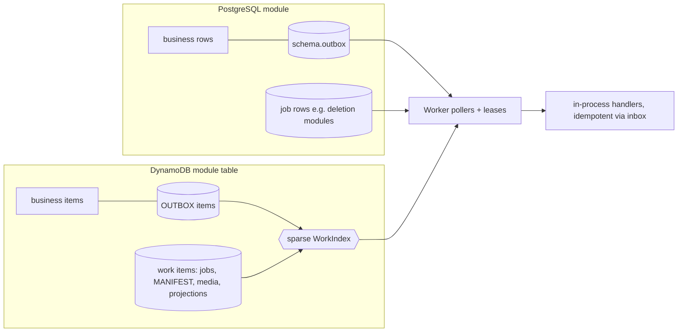

# 06 — Hybrid Database Architecture

Tags: [S] stated · [D] derived · [A] assumption · [R] recommendation
**Revision 0.3 (approved baseline):** media table (X-1); outbox without Streams and work items without SQS (§5, ADR-18); manifest TTL 30 s and snapshot retention (§6); retention per U13 (provisional); deletion lifecycle (§9).
Revision 0.2: hybrid design **accepted** (§1, §2.5); authoritative state vs. projections (§3, §4, §6); tenant data lifecycle (§9); local development (§8).

---

## 1. Decision [S] — **Accepted** (ADR-03, Rev 0.2)
- **DynamoDB** for menu and catalogue domains.
- **PostgreSQL** for orders and financial transactions.

## 2. Review of the decision (Rev 0.1 analysis, kept for context)

### 2.1 What the hybrid design does well
| Benefit | Detail |
|---------|--------|
| Catalogue scales with no capacity planning | On-demand DynamoDB, per-request billing, near-zero idle cost. |
| ACID money handling | Orders, payments, refunds and ledgers need multi-row transactions, constraints and ad-hoc reporting. PostgreSQL is the right tool. |
| Matches access patterns | Menus are read and written as whole aggregates ("load this menu"). That suits a key-value/document model. |

### 2.2 What it costs
| Cost | Detail |
|------|--------|
| Two persistence technologies | Two sets of tests, local dev setups, backup/restore runbooks, monitoring, migration tooling. |
| No cross-store transactions | Anything spanning both needs outbox/eventual consistency (e.g., tenant deletion). |
| DynamoDB requires knowing access patterns up front | New admin features (search, filter, "items without images", reporting) often need new GSIs or a search index. The admin portal is exactly where those requests appear. |
| Reporting | Catalogue analytics need export (DynamoDB → S3 export → Athena). |
| Team skills | Single-table DynamoDB design is a specialist skill. Mistakes are expensive to fix later. |

### 2.3 The key observation
**The highest-volume read path (customers viewing menus) should not hit DynamoDB at all.** It is served from S3/CloudFront snapshots (doc 04). DynamoDB's main strength, predictable latency at massive read scale, therefore applies mainly to **admin traffic, which is low**. The menu domain's actual workload (moderate writes, hierarchical documents, admin filtering) is something PostgreSQL with `jsonb` handles easily.

### 2.4 Options considered (Rev 0.1)

| Option | Description | When it's right |
|--------|-------------|-----------------|
| **A. Hybrid as stated** | DynamoDB (catalog/menus/publishing) + PostgreSQL (tenancy, billing, orders, payments) | Ordering + payments confirmed **and** team has DynamoDB experience **and** there's a strategic reason (e.g., very large catalogue scale, future multi-region active-active via Global Tables). |
| **B. PostgreSQL only** | All modules in PostgreSQL (separate schemas). Menus as relational tables plus `jsonb` for translations/overrides. S3+CDN snapshots for public reads. | Small team, fast delivery, heavy admin querying. |
| **C. DynamoDB only** | Including orders. | **Not recommended.** Financial records need constraints, transactions across many rows, and reporting. |

### 2.5 Decision (Rev 0.2): Option A accepted
Architecture Review 0.2 accepted the hybrid design. DynamoDB holds Catalog, Menu Authoring and Publishing metadata; PostgreSQL holds the relational and transactional domains. The costs in §2.2 are accepted and mitigated by:
- access patterns specified before implementation (doc 07);
- a `TenantIndex` GSI on every table, so all of a tenant's data can be enumerated (doc 07 §7);
- a single authoritative publication record, with S3 files as rebuildable projections (§6; doc 04 §4.1);
- a transactional outbox in both stores for cross-store consistency (§5);
- DynamoDB export to S3 + Athena for reporting;
- persistence hidden behind each module's repositories, so a module's store can still change later if ever needed.

## 3. Data placement (Option A)

| Data | Store | Reason |
|------|-------|--------|
| Tenants, locations, settings | PostgreSQL `tenancy` | Relational, referenced by orders and billing; low volume; needs constraints (unique slugs). |
| Users, memberships, roles | PostgreSQL `identity` | Relational many-to-many; permission checks. Credentials live in Cognito. |
| Subscriptions, plans, entitlements | PostgreSQL `billing` | Financial. |
| Catalogue items, modifiers, allergens, translations | DynamoDB `catalog` | Stated. |
| Menus, sections, placements, schedules, availability | DynamoDB `menus` | Stated. |
| Publication pointer (**authoritative**), publish jobs, published versions, routes, QR codes | DynamoDB `publishing` (authoritative) + S3 projections | Key-value lookups; one transactional source of truth; immutable blobs. |
| Media metadata, upload sessions | DynamoDB `media` table (Rev 0.3, X-1) | Owned by the Media module; key-value by asset ID. |
| AI jobs & suggestions (phase 2) | DynamoDB `ai` table with TTL | Short-lived documents; TTL auto-expiry. |
| AI usage ledger (phase 2) | PostgreSQL `ai` schema | Cost reporting, aggregations. |
| Orders, order lines, payments, refunds, ledger | PostgreSQL `ordering`, `payments` | Stated; ACID. **Out of MVP-1** (ADR-12); design retained. |
| Tenant deletion jobs and per-module progress | PostgreSQL `tenancy` | Orchestration state for §9. |
| Audit events | PostgreSQL `audit` (monthly partitions) → archived to S3 | Queryable by tenant/time; append-only. |
| Outbox | PostgreSQL `<schema>.outbox` tables; DynamoDB `OUTBOX` items in each module table (no Streams in MVP-1) | See §5. |
| Background work items | DynamoDB items in a sparse `WorkIndex`; PostgreSQL job rows (`SKIP LOCKED`) | Poller-only dispatch, no SQS (ADR-18). |
| Scan analytics (phase 2) | S3 (CloudFront standard logs) + Athena | No OLTP load. |

Retention for active and deleted tenants: doc 08 §6 (U13, provisional pending legal review).

## 4. Consistency model

| Interaction | Consistency | Mechanism |
|-------------|-------------|-----------|
| Within one menu (sections + placements) | Strong for the writer | Single partition; conditional writes with `version` attribute; `TransactWriteItems` for multi-item changes (≤ 100 items). |
| Draft → live menu | Eventual (seconds) | Publish job state machine. The authoritative pointer is committed in one transaction; projections are rebuilt idempotently (doc 04 §4.1). |
| Authoritative pointer → public files | Eventual (≤ ~30 s after LIVE, by TTL) | Per-location `MANIFEST` dirty state rebuilt under a lease; reconciler every 5 min. Customers always see a complete earlier or later version, never a mix. |
| Catalog item edit → menus that use it | Eventual | `ItemChanged` outbox item (same transaction as the item write) → worker poller → menus flagged "unpublished changes". **Published menus never change implicitly.** A change becomes visible only after a republish. |
| Order ↔ menu | Snapshot | Order line copies name, price, modifiers, tax category from the **published version** the guest saw; server re-validates the price against that version. |
| Tenant lifecycle ↔ catalogue | Eventual | `TenantSuspended`/`TenantDeletionScheduled` events via the PostgreSQL outbox → worker poller → handlers in each module; deletion via per-module job rows (doc 07 §7.3). |

## 5. Event propagation and background work (Rev 0.3, ADR-18)



- **PostgreSQL modules:** business rows and an `<schema>.outbox` row in one transaction. The poller reads `published_at IS NULL`. Job rows are claimed with `FOR UPDATE SKIP LOCKED` plus a lease.
- **DynamoDB modules:** business items and an `OUTBOX` item (`T#{t}#OUTBOX / EVT#{ulid}`) in one `TransactWriteItems`. Work items carry WorkIndex attributes while pending and are claimed with a conditional update and a lease.
- **Dispatch:** worker pollers every 2–5 s dispatch events to in-process handlers. Handlers are idempotent via an inbox (`<schema>.inbox`, or DynamoDB `INBOX#` items with TTL, tagged with `TENANT_*`). Handlers skip events for non-active tenants.
- **No SQS and no DynamoDB Streams in MVP-1.** Why: one mechanism locally and in AWS, less infrastructure, and purge deletes can't trigger downstream reactions. Revisit trigger: volume or latency beyond polling; then SQS is introduced behind the same interfaces.
- Polling cost: a handful of eventually consistent queries per poller every few seconds, which is negligible on on-demand pricing at MVP volume.

## 6. Public read model (store-independent)

**Principle (Rev 0.2): DynamoDB holds the authoritative state. Every public S3 file is a derived projection** that can be deleted and rebuilt from it, and public files are never read to make write decisions. The authoritative publication pointer and publish failure handling are described in doc 04 §4.1 and doc 07 §3.3.

```
s3://ms-{env}-public-data/        (served by CloudFront under /data/)
  data/t/{tenantId}/snapshots/{sha256}.json                   # immutable, content-addressed menu snapshot; long cache
  data/t/{tenantId}/locations/{locationId}/manifest.json      # projection: live menus, schedules, snapshot URLs, tenant status, builtVersion; Cache-Control max-age=30 (invalidated only on suspension/deletion)
  data/t/{tenantId}/locations/{locationId}/availability.json  # sold-out overlay; ~10 s TTL  [A]
  data/qr/{code}.json                                         # projection of the QR item: tenantId, locationId, slugs, manifest path, status
  data/routes/{tenantSlug}/{locationSlug}.json                # projection of the ROUTE item: tenantId, locationId, manifest path (or redirect after a slug rename)
```
- Snapshot JSON is fully denormalized: sections, items, resolved overrides, image rendition URLs, allergens, all languages (or one file per language if large).
- Size guidance: keep < 500 KB uncompressed; split per language beyond that.
- **Why tenantId, not slug, in the data paths:** slugs can change; IDs don't. Public URLs use slugs, which are resolved through the route projection files.
- QR and route files are outside the tenant prefix because they're looked up by code or slug. Tenant deletion removes them by an explicit key list (doc 07 §7.3).
- Snapshot retention: snapshots not referenced by any retained `VER#` item are deleted by a cleanup job (the last 50 versions per menu are retained; unreferenced snapshots are deleted after a 7-day grace period, longer than any cache TTL).

## 7. Backup, restore and DR
| Store | Backup | Restore test |
|-------|--------|--------------|
| PostgreSQL | Automated backups + PITR (7–35 days); Multi-AZ | Quarterly restore drill to staging |
| DynamoDB | PITR on all tables (35 days); on-demand backups before risky migrations | Quarterly restore to new table + verification |
| S3 | Versioning on media and published buckets; lifecycle to IA/Glacier; optional cross-region replication | Spot-check |
| Public projections (manifests, QR/route files) | **Rebuilt** from authoritative DynamoDB state by the reconciler. Snapshots are content-addressed from `VER#` records, or rebuilt by republishing. | Part of DR runbook |

Per-tenant restore (one tenant's accidental deletion) isn't possible with whole-table PITR. **Soft delete with a 30-day grace period** on menus/items covers the most common case. → confirm whether a requirement exists.

## 8. Local development
- PostgreSQL: Docker / Testcontainers, using the same major version as RDS (verified at environment preparation, doc 10 §3).
- DynamoDB: DynamoDB Local or LocalStack, with tables (including `TenantIndex`) created from a table definition shared by Terraform and tests.
- S3 (with versioning and conditional writes): LocalStack, or MinIO if the free edition lacks a feature.
- Background work and outbox dispatch: worker pollers in every environment (no SQS or Streams), so local and AWS behave the same.
- DynamoDB Local makes GSIs immediately consistent; tests simulate index lag with a decorator (doc 12 R-1).
- Full local stack: doc 10 §4.

## 9. Tenant data lifecycle across both stores (Rev 0.2)
- **Enumeration:** DynamoDB uses the `TenantIndex` GSI on every table (a Query can't reach child partitions from a parent key). PostgreSQL uses `tenant_id` on every tenant-owned row. S3 uses the `t/{tenantId}/` and `data/t/{tenantId}/` prefixes, plus QR/route keys taken from the Publishing items.
- **Deletion:** tenant guard BLOCKED and manifests unavailable at scheduling → grace period (30 days, provisional) → quiet period → each module purges its own store (projections first, then authoritative items, then verification passes at 30 min and 24 h) → S3 versions and delete markers → identities without other memberships → supervisor finalizes. Financial records (future) are anonymized, not deleted. Details: doc 07 §7, doc 08 §4.1.
- **Backups:** deleted data remains in PITR and backup copies until they expire (up to 35 days). This must be stated in the privacy policy.
