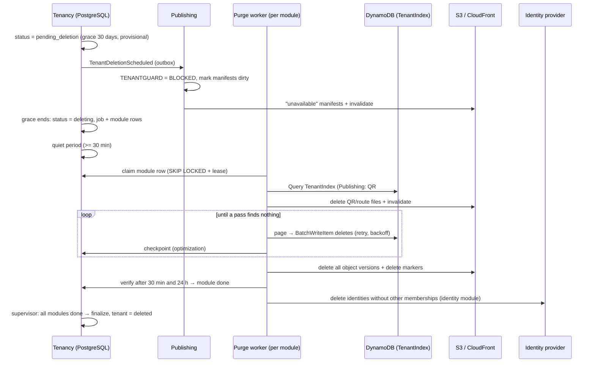

# 07 — Initial DynamoDB Access Patterns and Key Design

Tags: [S] stated · [D] derived · [A] assumption · [R] recommendation
Applies to the accepted hybrid design in [06](06-hybrid-database-architecture.md) (ADR-03).
**Revision 0.3 (approved baseline):** writer, upsert, key and outbox rules (§1 principles 10–14); Publishing table redesigned (§3.3: ACTIVEJOB, JOB#{ulid}, MANIFEST, TENANTGUARD, full-state VER, WorkIndex); Media table (§3.5, X-1); deletion procedure rewritten (§7, TI-1…TI-13); no Streams (ADR-18).
Revision 0.2: tenant enumeration and deletion fixed (§1 principle 9, §7 new); Publishing table redesigned around one authoritative publication pointer (§3.3); QR identifiers raised to 128 bits (§3.3.1); LeadingKeys pattern corrected (§4).

---

## 1. Design principles [R]

1. **One table per module, single-table design inside each module.** One table for the whole system would break module data ownership (doc 05, rule 2) and couple IAM policies. Splitting further than per module wastes the benefits of single-table design.
2. **Tenant ID is the leading part of every partition key** for tenant-owned data. This makes isolation enforceable with IAM `dynamodb:LeadingKeys` (doc 09).
3. **Generic key names** (`PK`, `SK`, `GSI1PK`, `GSI1SK`) plus an explicit `entityType` attribute.
4. **Optimistic concurrency** on every mutable aggregate: `version` number attribute plus `ConditionExpression`.
5. **Sort order lives in an attribute** (`sortOrder`, fractional/lexicographic rank), **not in the sort key**. Otherwise a drag-and-drop reorder would need delete+put of many items.
6. **IDs:** ULIDs, which are sortable by time, URL-safe and generated without coordination.
7. **Item size:** keep each item well under the 400 KB limit. Translations are embedded maps at first, with a fallback to separate items if they grow (see §6).
8. Capacity: **on-demand**, PITR on, server-side encryption with a customer-managed KMS key, deletion protection on.
9. **Every tenant-owned item carries `TENANT_PK` / `TENANT_SK`**, indexed by a keys-only `TenantIndex` GSI on every table. A Query matches exactly one partition key, so `PK = T#t` can never reach child partitions such as `T#t#M#m`. Tenant-wide enumeration always uses the TenantIndex (§7).
10. **One writer (TI-2).** Every Put/Update/Delete, including transaction and batch members, goes through `DynamoItemWriter` in BuildingBlocks. SDK write calls elsewhere fail an architecture test. PartiQL is not used.
11. **No accidental upserts (TI-1).** Every `UpdateItem` sets `TENANT_PK = if_not_exists(TENANT_PK, :tpk)` and `TENANT_SK = if_not_exists(TENANT_SK, :tsk)`. Updates of existing aggregates include `attribute_exists(PK)`. Intentional upserts (`MANIFEST`, `TENANTGUARD`, counters) are explicit writer options. `REMOVE` never names `PK`, `SK` or `TENANT_*`.
12. **Key character rules (TI-7).** Table key segments use `[A-Za-z0-9_-]`; `#` and `|` are delimiters only. Slugs `^[a-z0-9]+(-[a-z0-9]+)*$`, ≤ 63 characters. No user text in table keys; table keys ≤ 1,024 bytes so `TENANT_SK` fits the GSI sort-key limit. GSI1 sort keys may contain normalized names truncated to 100 characters. The writer validates.
13. **Transactional outbox and work items; no Streams or SQS in MVP-1 (ADR-18).** Events are `T#{t}#OUTBOX / EVT#{ulid}` items written in the same transaction as the change. Background work is items with a lease. Both are found through a sparse **`WorkIndex`** (GSI2: `GSI2PK = WORK#{type}[#{status}]`, `GSI2SK = {timestamp}`) on every module table, single shard (PUB-14), removed when the work is done.
14. **Bulk pacing (TI-13).** Bulk writes are paced (≤ 200 items/s per tenant); alarm on GSI throttle events.

## 2. Access patterns (complete list for MVP)

### Catalog module
| # | Access pattern | Actor | Frequency |
|---|---------------|-------|-----------|
| C1 | Get item by ID | Admin | High |
| C2 | List all items for a tenant (paginated, ~ hundreds–low thousands) | Admin | Medium |
| C3 | List items by status (active/archived) | Admin | Medium |
| C4 | Create/update/archive item with concurrency check | Admin | Medium |
| C5 | Batch get items by IDs (publish build) | Worker | Medium |
| C6 | Get/list modifier groups for tenant | Admin | Medium |
| C7 | Get media asset metadata (moved to the Media table, §3.5) | Admin/Worker | Medium |
| C8 | Enumerate all tenant data for export/deletion (**every table, every partition**, see §7) | Worker | Rare |
| C9 | Search items by text | Admin | Medium — **see §5** |

### Menus module
| # | Access pattern | Actor | Frequency |
|---|---------------|-------|-----------|
| M1 | List menus for tenant | Admin | High |
| M2 | Get full draft menu (header + sections + placements) in one query | Admin, Worker | High |
| M3 | Add/update/remove section or placement (conditional on menu version) | Admin | High |
| M4 | Reorder sections/placements | Admin | Medium |
| M5 | List menus assigned to a location | Admin, Worker | Medium |
| M6 | Find all menus/placements that use item X (impact of item change) | Worker | Medium |
| M7 | Set item availability (sold out) per location (**phase 2**, U6) | Staff | High at peak |
| M8 | Get availability for a location (**phase 2**) | Worker | High at peak |

### Publishing module
| # | Access pattern | Actor | Frequency |
|---|---------------|-------|-----------|
| P1 | Read QR code → target (tenant, location, menu?, table?). Guests read the **S3 projection**, not DynamoDB. | Projection builder, Admin | Low |
| P2 | List QR codes for tenant / location | Admin | Low |
| P3 | Read public route (`tenantSlug/locationSlug`) → tenant/location. Guests read the S3 projection. | Projection builder | Low |
| P4 | Record published version (immutable) | Worker | Low |
| P5 | List published versions for a menu (history, newest first) | Admin | Low |
| P6 | Get live menus for a location (from the authoritative state) | Manifest builder | Medium |
| P7 | Ensure QR code / slug uniqueness across the platform | Admin | Low |
| P8 | Create, claim and complete publish jobs; find stuck jobs across tenants | API, Worker, Reconciler | Medium |
| P9 | Commit a publication atomically (guard + pointer + version + location index + job + lock + outbox) | Worker | Low |
| P10 | Mark, claim and clear per-location manifest state | Worker | Medium |
| P11 | Poll and dispatch outbox events and pending projections | Worker | High (polling) |

### AI module (phase 2)
| # | Access pattern | Actor |
|---|---------------|-------|
| A1 | Create job; update status | API/Worker |
| A2 | Get job + its suggestions | Admin |
| A3 | List recent jobs for tenant | Admin |
| A4 | Auto-expire old jobs/suggestions (TTL, e.g., 30 days) | System |

## 3. Key design

### 3.1 Table `ms-{env}-catalog`

| Entity | PK | SK | GSI1PK | GSI1SK | Notes |
|--------|----|----|--------|--------|-------|
| Item | `T#{tenantId}` | `ITEM#{itemId}` | `T#{tenantId}#ITEMSTATUS#{status}` | `{nameNormalized}#{itemId}` | Attributes: name{lang}, description{lang}, price (minor units) + currency, variants[], modifierGroupIds[], allergens[] (default scheme: FDA nine major allergens), dietary[], calories? (optional, pending L3), imageAssetId, status, version, updatedAt, updatedBy. `GSI1SK` name truncated to 100 characters |
| Modifier group | `T#{tenantId}` | `MODGRP#{groupId}` | — | — | options[] embedded (name{lang}, priceDelta), min/max selections |
| Catalog settings | `T#{tenantId}` | `SETTINGS` | — | — | default language, enabled allergen scheme |

Pattern mapping:
- C1 `GetItem(PK=T#t, SK=ITEM#i)`
- C2 `Query(PK=T#t, SK begins_with ITEM#)` paginated
- C3 `Query(GSI1, GSI1PK=T#t#ITEMSTATUS#ACTIVE)` — sorted by name for admin lists
- C4 `PutItem/UpdateItem ... ConditionExpression version = :expected`
- C5 `BatchGetItem` (≤ 100 keys per call; chunk)
- C6 `Query(PK=T#t, SK begins_with MODGRP#)`
- C7 → Media table (§3.5)
- Item writes that affect menus put an `ItemChanged`/`ItemArchived` outbox item in the same `TransactWriteItems` (principle 13).
- C8 `Query(TenantIndex, TENANT_PK=T#t)` (§7). `Query(PK=T#t)` happens to cover the catalogue today because all catalogue items sit in the root partition, but the rule is uniform across tables, so a future child partition can't silently escape deletion.

> **Partition size note:** all of a tenant's catalogue in one partition key is fine: items are small, throughput per partition (3,000 RCU / 1,000 WCU) is far above admin traffic, and there's no LSI (so no 10 GB item-collection limit). Revisit only for tenants with tens of thousands of SKUs ("shops"?).

### 3.2 Table `ms-{env}-menus`

| Entity | PK | SK | GSI1PK | GSI1SK | Notes |
|--------|----|----|--------|--------|-------|
| Menu header | `T#{tenantId}` | `MENU#{menuId}` | — | — | name{lang}, status (DRAFT/PUBLISHED/ARCHIVED), draftVersion, lastPublishedInfo (**display-only projection**; the authoritative pointer is in Publishing, §3.3), hasUnpublishedChanges, locationIds (set), schedule[], version |
| Location assignment | `T#{tenantId}` | `LOCMENU#{locationId}#{menuId}` | — | — | written in the same transaction as the header's `locationIds` |
| Menu meta (in menu partition) | `T#{tenantId}#M#{menuId}` | `META` | — | — | small copy: draftVersion (the concurrency anchor for the whole menu) |
| Section | `T#{tenantId}#M#{menuId}` | `SEC#{sectionId}` | — | — | name{lang}, description{lang}, sortOrder, visibility |
| Placement | `T#{tenantId}#M#{menuId}` | `PLC#{sectionId}#{itemId}` | `T#{tenantId}#I#{itemId}` | `M#{menuId}#{sectionId}` | sortOrder, priceOverride?, hidden?, soldOut? (U6, applied on publish), badge? |
| Availability (phase 2, U6) | `T#{tenantId}#L#{locationId}` | `AVAIL#{itemId}` | — | — | soldOut: true, until?, setBy; TTL on `until` |

Pattern mapping:
- M1 `Query(PK=T#t, SK begins_with MENU#)`
- M2 `Query(PK=T#t#M#m, ConsistentRead=true)` returns META + all sections + placements; client sorts by `sortOrder`. Typical menu < 300 items, a few hundred KB → 1–2 pages.
- M3 `TransactWriteItems`: [ConditionCheck/Update `META` version = expected, increment] + [Put/Update/Delete section or placement] + [Update header `hasUnpublishedChanges=true`]. This gives **menu-level optimistic locking** (FR-MENU-09). **Header edits** (name, locations, schedule) use the same pattern and also increment `META.draftVersion`, so the publish snapshot check covers them (PUB-4). Maximum 90 locations per menu (doc 11 T7).
- M4 Reorder = update `sortOrder` on the moved item(s) only (fractional rank), in the same transaction pattern.
- M5 `Query(PK=T#t, SK begins_with LOCMENU#{l}#)`
- M6 `Query(GSI1, GSI1PK=T#t#I#{i})` → menus/sections where item is placed.
- M7 `PutItem/DeleteItem` on AVAIL; then API rewrites the location's `availability.json` (debounced).
- M8 `Query(PK=T#t#L#l, SK begins_with AVAIL#)`

**Why a separate menu partition (`T#t#M#m`) instead of putting sections in `T#t`:** M2 can load the whole draft in one query without reading the rest of the tenant, and all writes to one menu go to one partition. Menu headers stay in the tenant partition so M1 (list menus) is a single query. **Child partitions (`T#t#M#m`, `T#t#L#l`) can't be found by querying `PK=T#t`**, so tenant-wide enumeration uses the TenantIndex (§7), not parent items.

### 3.3 Table `ms-{env}-publishing` (Rev 0.3 baseline)

There is one authoritative publication record per menu (`CURRENT`). The location index items are written only in the same transaction. A per-menu `ACTIVEJOB` lock serializes PUBLISH, ROLLBACK and UNPUBLISH. Per-location `MANIFEST` state drives projection, and `TENANTGUARD` fences commits. Flow and failure handling: doc 04 §4.1.

| Entity | PK | SK | GSI1PK / GSI1SK | WorkIndex GSI2PK / GSI2SK (sparse) | Notes |
|--------|----|----|-----------------|------------------------------------|-------|
| **Menu publication pointer (authoritative)** | `T#{t}#M#{m}` | `CURRENT` | — | — | status (LIVE/UNPUBLISHED), publishNumber, snapshotKey, checksum, sourceDraftVersion, liveDraftVersion, locationIds, schedule, publishedAt/By, pointerRevision, rolledBackTo? |
| Published version (immutable) | `T#{t}#M#{m}` | `VER#{zero-padded n}` | — | — | snapshotKey, checksum, sourceDraftVersion, **locationIds, schedule**, publishedAt/By, itemCount, jobId, rolledBackTo? |
| Active-job lock | `T#{t}#M#{m}` | `ACTIVEJOB` | — | — | jobId, type, draftVersion?, createdAt; exists only while a job is non-terminal |
| Publish job | `T#{t}#M#{m}` | `JOB#{ulid}` | — | `WORK#JOB#{status}` / `{updatedAt}` while REQUESTED, BUILDING or COMMITTED | type (PUBLISH/ROLLBACK/UNPUBLISH), status, draftVersion?, targetPublishNumber?, expectedRevision, leaseOwner, leaseUntil, attempt, affectedLocations, awaitVersions, error, requestedBy, `ttl` (90 days after terminal) |
| Location publication index | `T#{t}#L#{l}` | `PUB#{m}` | — | — | publishNumber, pointerRevision; only written in the same transaction as `CURRENT` |
| Location manifest state | `T#{t}#L#{l}` | `MANIFEST` | — | `WORK#MANIFEST` / `{dirtySince}` while dirty | dirtyVersion, builtVersion, dirty, buildLeaseOwner, buildLeaseUntil, builtAt |
| Tenant guard | `T#{t}` | `TENANTGUARD` | — | — | status (ACTIVE/BLOCKED); created on `TenantCreated`; BLOCKED on suspension or scheduled deletion; deleted last by purge |
| QR code (authoritative) | `QR#{code}` | `QR` | `T#{t}` / `QR#{l}#{code}` | `WORK#PROJ` / `{updatedAt}` while projection pending | tenantId, locationId, menuId?, status (ACTIVE/REVOKED), revision, projectedRevision, createdAt/By |
| Public route | `ROUTE#{tenantSlug}#{locationSlug}` | `ROUTE` | `T#{t}` / `ROUTE#{l}` | `WORK#PROJ` / `{updatedAt}` while pending | tenantId, locationId, redirectTo? (after a rename), revision, projectedRevision; projection of `tenancy.locations` |
| Outbox event | `T#{t}#OUTBOX` | `EVT#{ulid}` | — | `WORK#OUTBOX` / `{createdAt}` until dispatched | type, payload, `ttl` (7 days after dispatch) |

All items carry `TENANT_PK`/`TENANT_SK` (§7), including `QR#` and `ROUTE#`. Removing the WorkIndex attributes never touches keys or `TENANT_*` (principle 11).

Pattern mapping:
- **P1** `GetItem(PK=QR#c, SK=QR)` by the projection builder and admin. Guests read `data/qr/{code}.json` from the CDN.
- **P2** `Query(GSI1, GSI1PK=T#t, GSI1SK begins_with QR#{l}#)`
- **P3** `GetItem(PK=ROUTE#ts#ls, SK=ROUTE)` by the projection builder. Guests read `data/routes/...json`.
- **P4** `Put VER#n ... attribute_not_exists(PK)`, only inside P9.
- **P5** `Query(PK=T#t#M#m, SK begins_with VER#, ScanIndexForward=false)`
- **P6** `Query(PK=T#t#L#l, SK begins_with PUB#)` → `BatchGetItem(ConsistentRead=true)` of each menu's `CURRENT` → manifest.
- **P7** Uniqueness: `PutItem attribute_not_exists(PK)` on `QR#`/`ROUTE#`. Slug rename = transaction: put the new route, turn the old one into a redirect (grace period). Source of truth for slugs: PostgreSQL `tenancy.locations`.
- **P8** Jobs. Request: `TransactWriteItems` [Put `ACTIVEJOB` (`attribute_not_exists`), Put `JOB#{ulid}`]. On lock conflict, `GetItem ACTIVEJOB`: same type and draftVersion → return its job; else 409. Claim: `UpdateItem` with condition `status = REQUESTED OR (status = BUILDING AND leaseUntil < :now)`. Poller: `Query(GSI2, GSI2PK = WORK#JOB#REQUESTED)` and `WORK#JOB#BUILDING` with `GSI2SK < :now − lease`.
- **P9** Commit: `TransactWriteItems` [ConditionCheck `TENANTGUARD` (status = ACTIVE); Update `CURRENT` (`attribute_not_exists(PK) OR pointerRevision = :expected`); Put `VER#n`; Put/Delete `PUB#` (changed locations); Update job (status = BUILDING AND leaseOwner = :me); Delete `ACTIVEJOB` (jobId = :job); Put outbox event]. 7 fixed actions + changed locations ≤ 100 → **validation limit: 90 locations per menu**.
- **P10** Manifest state. Mark: `UpdateItem ADD dirtyVersion :one SET dirty = :true, dirtySince = if_not_exists(dirtySince, :now), GSI2PK = :work, GSI2SK = :now` (an intentional upsert; tags set by the writer). Claim: condition `dirty = :true AND (attribute_not_exists(buildLeaseUntil) OR buildLeaseUntil < :now)`. Clear: `SET builtVersion = :v, dirty = :false REMOVE GSI2PK, GSI2SK, dirtySince` with condition `dirtyVersion = :v AND buildLeaseOwner = :me`; **on failure, re-mark** (`ADD dirtyVersion 1`).
- **P11** Outbox and projections: `Query(GSI2, GSI2PK = WORK#OUTBOX)` and `WORK#PROJ`, oldest first; after processing, `REMOVE GSI2PK, GSI2SK` (+ `ttl` for outbox items).

#### 3.3.1 QR code identifiers (ADR-11)
- **128 random bits** from a cryptographically secure generator (`System.Security.Cryptography.RandomNumberGenerator`), base64url-encoded without padding → **22 characters** (requirement: ≥ 96 bits). Check legibility at the smallest supported print size.
- Never derived from tenant, location or table IDs; never sequential; never reused after revocation. Uniqueness via a conditional put, with regeneration on the (practically impossible) conflict.
- The alphabet matches the key character rules (principle 12), so the code can be parsed from `PK` during deletion. The CloudFront Function rejects anything that doesn't match `^[A-Za-z0-9_-]{22}$`.
- Codes are **public bearer identifiers, not secrets**. Entropy stops discovery of *other* codes by guessing; it doesn't protect a code that has been seen.
- Rate limiting and miss detection: doc 09 §4.6.

### 3.4 Table `ms-{env}-ai` (phase 2 — created with AI menu import)
| Entity | PK | SK | Notes |
|--------|----|----|-------|
| Job | `T#{tenantId}` | `JOB#{ulid}` | type, status, inputRef (S3), model, promptVersion, createdBy, `ttl` |
| Suggestion | `T#{tenantId}#JOB#{jobId}` | `SUG#{n}` | target (item/section), proposed fields, status (PENDING/ACCEPTED/REJECTED), `ttl` |

A3 = `Query(PK=T#t, SK begins_with JOB#, ScanIndexForward=false, Limit=20)` (ULIDs sort by time).

### 3.5 Table `ms-{env}-media` (Rev 0.3, X-1)

| Entity | PK | SK | WorkIndex (sparse) | Notes |
|--------|----|----|--------------------|-------|
| Upload session | `T#{t}` | `UPLOAD#{ulid}` | — | presigned key `t/{t}/uploads/{assetId}`, expected content type and maximum size, expiresAt, `ttl` |
| Media asset | `T#{t}` | `MEDIA#{assetId}` | `WORK#MEDIA` / `{updatedAt}` while PENDING | status (PENDING/PROCESSING/READY/REJECTED), renditions{size: key under `t/{t}/processed/`}, contentType, bytes, width, height, leaseOwner, leaseUntil, attempt, createdBy |
| Outbox event | `T#{t}#OUTBOX` | `EVT#{ulid}` | `WORK#OUTBOX` / `{createdAt}` until dispatched | e.g., `MediaReady` |

Patterns: **MD1** get asset (`GetItem`); **MD2** create upload session (`PutItem`) → client PUTs to S3 with the presigned URL → **MD3** "complete upload" call sets the asset to PENDING (adds WorkIndex attributes); **MD4** worker claims (`status = PENDING`, or PROCESSING with an expired lease), validates magic bytes, strips EXIF, writes WebP renditions, sets READY or REJECTED and removes the WorkIndex attributes; **MD5** list assets (`Query begins_with MEDIA#`). All items carry `TENANT_*`.

## 4. Tenant isolation in keys
- All tenant-owned partition keys start with `T#{tenantId}`. The exceptions are `QR#` and `ROUTE#`, which are **public lookup entries** containing no sensitive data, and are only writable by the Publishing module's role.
- The repository layer never accepts a raw PK from callers. It builds keys from `ITenantContext.TenantId`.
- `QR#` and `ROUTE#` items still carry `TENANT_PK`, so tenant enumeration and deletion find them (§7).
- Defense in depth: IAM session policies scoped with `dynamodb:LeadingKeys` matching **exactly** `T#{tenantId}` **or** `T#{tenantId}#*` for tenant-scoped operations (doc 09 §4.3). *Corrected in 0.2:* the Rev 0.1 pattern `T#{tenantId}*` had no separator boundary. Fixed-length UUID tenant IDs make a prefix collision impossible in practice, but the pattern should be exact anyway.

## 5. What DynamoDB does poorly here
| Need | Problem | Approach |
|------|---------|----------|
| C9 Item text search, filters by allergen/price/"no image" | No secondary text search | MVP: load the tenant's item list (C2, cached) and filter in the client/API, fine up to ~2–5k items. Later (T4): OpenSearch Serverless fed by outbox events **(added cost)**. |
| Cross-tenant platform reporting | Scans are expensive | DynamoDB export to S3 (incremental) → Athena. |
| Ad-hoc "where is this modifier used" | Needs another GSI | Add GSI when confirmed; GSIs can be added online. |

## 6. Open design questions that affect keys
1. **Expected item count per tenant?** Still open (M8). Affects §3.1 partition strategy and search (T4).
2. ~~Languages per item~~ — **Resolved (U5):** default + up to 4 languages, embedded maps. Split into `ITEM#{id}#L#{lang}` items only if this limit is raised.
3. ~~Item reuse across menus~~ — **Resolved (U3):** yes; the catalog + placement model stays.
4. ~~Price per location~~ — **Phase 2 (U3).** Would add per-location price maps or per-location snapshots.
5. **Draft edit history / undo beyond published versions?** Not in MVP-1. Would need an event log (outbox → S3).

## 7. Tenant data enumeration, export and deletion (Rev 0.3 baseline, ADR-09)

### 7.1 Problem (Rev 0.1 flaw)
A DynamoDB `Query` matches **exactly one partition key value**, and partition keys can't be matched with `begins_with`. `Query(PK = "T#t")` returns only the tenant root partition. It can't return items under `T#t#M#m`, `T#t#L#l` or `T#t#OUTBOX`, or the tenant's `QR#`/`ROUTE#` items. Deriving child keys from parent items fails with orphaned children, IDs owned elsewhere (locations live in PostgreSQL) and items in other tables.

### 7.2 TenantIndex on every module table

| Attribute | Value | Present on |
|-----------|-------|-----------|
| `TENANT_PK` | `T#{tenantId}` | Every tenant-owned item in every table (catalog, media, menus, publishing; ai in phase 2), including `QR#`, `ROUTE#`, `OUTBOX`, `INBOX#`, work items |
| `TENANT_SK` | `{PK}|{SK}` | Same items |

GSI `TenantIndex`: partition key `TENANT_PK`, sort key `TENANT_SK`, projection **KEYS_ONLY**. A GSI projection always includes the table's `PK` and `SK`, so `DeleteItem` needs nothing more. QR codes and route slugs are parsed from `PK` to delete their S3 files.

Guarantees:
- **Write path (TI-1, TI-2):** `DynamoItemWriter` sets both attributes on every Put and, with `if_not_exists`, on every Update, including transaction and batch members. No accidental upserts. An architecture test forbids SDK writes elsewhere (principles 10–11).
- **Coverage (TI-3):** after the integration suite, every local table is scanned. Any item without `TENANT_*` that isn't on the explicit platform-item allow-list fails the build. The monthly orphan audit (§7.4) also counts untagged items in AWS.
- **Collision safety (TI-7, X-6):** `TENANT_SK` is unique by construction, because `|` can't occur in table keys (principle 12). Uniqueness isn't required by the GSI anyway: GSI keys may repeat, and pagination keys include the table keys.

| Benefit | Cost |
|---------|------|
| Complete and uniform enumeration | One extra small index write per item write |
| Unaffected by orphans and partial failures | Eventually consistent index → verification passes |
| Same mechanism for export | One GSI partition per tenant → pace bulk writes (principle 14) |

Rejected alternatives: deriving children from parents; partition registry items; table scans (only for the audit); a table per tenant.

### 7.3 Deletion procedure

1. **Schedule.** Owner requests deletion → tenant `pending_deletion`. Grace period **30 days (provisional, pending legal review)**, cancellable. `TenantDeletionScheduled` → Publishing sets `TENANTGUARD = BLOCKED` and marks every location dirty → "unavailable" manifests (invalidated). The API rejects writes (`ITenantContext` status gate, cache ≤ 60 s). Cancellation reverses this.
2. **Start.** When the grace period ends, Tenancy sets `deleting` and creates `tenant_deletion_jobs` + one `tenant_deletion_module_status` row per module (doc 08 §4.1). Every worker checks tenant status before each write; pollers and handlers skip work and events for non-active tenants; projection builders write nothing (TI-6).
3. **Quiet period ≥ 30 min** (longer than any job lease plus the status cache TTL) before purging starts. In-flight publish commits fail on the guard anyway.
4. **Module purge** (worker claims its module row with `FOR UPDATE SKIP LOCKED` and a lease; idempotent and resumable):
   1. **Publishing first:** list `QR#`/`ROUTE#` items via the TenantIndex, delete their S3 files and invalidate those paths, then the items. `TENANTGUARD` is deleted last.
   2. For each table, a **pass**: page through `Query(TenantIndex, TENANT_PK = T#t)`. For each page, `BatchWriteItem` deletes (≤ 25, keys de-duplicated). Retry `UnprocessedItems` **and** throttling exceptions with exponential backoff + jitter; after 8 attempts the module row → `failed`. `LastEvaluatedKey` is stored as a **checkpoint only as an optimization**: on resume, the current pass restarts, which is safe because deletes are idempotent (TI-9).
   3. A pass that finds nothing ends the loop. **Verification passes** run 30 min later and again 24 h later (`verify_after`); anything found restarts the loop. Only then → `done`.
   4. **S3 (TI-11):** `ListObjectVersions` on `t/{tenantId}/` (media bucket), `data/t/{tenantId}/` (public-data bucket) and `t/{tenantId}/` (exports bucket) → `DeleteObjects` for every version **and delete marker** → a verification listing must be empty. A lifecycle rule expiring non-current versions is the backstop.
   5. **Identity module (TI-12):** remove the tenant's memberships; delete the user row and the IdP identity (Keycloak/Cognito) only if no other memberships remain.
5. **Supervisor (TI-10, every 15 min):** expired leases become reclaimable; `failed` rows retry with backoff and alarm after 3 failures. When every module is `done`: delete the remaining tenant rows in PostgreSQL (settings, locations, flags, audit events per doc 08 §6), keep the minimal deletion record, set `deleted`, and write a platform audit event.
6. **Not deleted immediately (documented in the privacy policy):** PITR/backups (≤ 35 days), application logs (30 days), CDN copies (TTL ≤ 5 min; QR/route paths invalidated), sub-processor copies per their terms. Orphan-audit exports are deleted right after the audit.
7. **No Streams in MVP-1 (TI-5):** purge deletes produce no downstream events. If Streams are introduced later, their consumers must ignore `REMOVE` records for non-active tenants and for TTL deletions.

Permissions: purging runs under a dedicated purge-worker role (TenantIndex query, delete items, S3 version deletes, IdP admin). The API role can't query the TenantIndex (doc 09 §4.3).

### 7.4 Export and orphan audit
- **Export:** TenantIndex enumeration + `BatchGetItem` (or direct partition queries) → JSON (CSV is flex scope) in `t/{tenantId}/exports/` → presigned link valid 24 h; object deleted after 7 days.
- **Monthly orphan audit:** DynamoDB export to S3 → Athena: `TENANT_PK` values without an active or pending tenant in PostgreSQL, plus untagged items → alarm. The export files themselves expire within 7 days.

### 7.5 Required tests (protected, doc 10 §12.2)
Coverage scan; deletion end-to-end with two tenants (the other tenant intact); worker killed at each purge step; publish and media jobs in flight during purge; a multi-tenant user; S3 versions and delete markers; supervisor recovery; simulated index lag.
