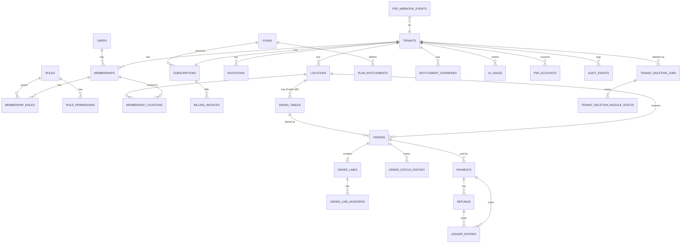

# 08 — PostgreSQL Entity Relationship Design

Tags: [S] stated · [D] derived · [A] assumption · [R] recommendation
**Revision 0.3 (approved baseline):** provider-neutral identity (X-2); `tenants.plan_key` (U7); deletion-module leases (TI-10); retention per U13 (provisional); `ai` schema in phase 2.
Revision 0.2: ordering/payments out of MVP-1 (design kept, schemas not created); PostgreSQL version verified at environment preparation; multiple locations accepted; tenant deletion tracking tables added.

---

## 1. Scope of PostgreSQL
| Schema | Module | Status |
|--------|--------|--------|
| `tenancy` | Tenancy & Org | Needed regardless [D] |
| `identity` | Identity & Access | Needed regardless [D] |
| `billing` | Subscription Billing | **Deferred** (U7). MVP-1 uses `tenants.plan_key` + static limits in configuration. |
| `ordering` | Ordering | **Out of MVP-1 (Rev 0.2, ADR-12).** Design kept; schema not created until that phase. |
| `payments` | Payments | **Out of MVP-1 (Rev 0.2, ADR-12).** Design kept; schema not created until that phase. |
| `ai` | AI usage ledger | **Phase 2** (created with AI menu import) |
| `audit` | Audit | Needed regardless [D] |
| `<module>.outbox`, `<module>.inbox` | Messaging | Needed regardless [R] |

## 2. Conventions [R]
- **PostgreSQL version:** the latest major supported by **both** Amazon RDS and the Npgsql EF Core provider for .NET 10. This is **verified when preparing the implementation environment** (doc 10 §3), not fixed here. The same major runs locally in Docker.
- Primary keys: `uuid` (UUIDv7, sortable by time, generated in the app) named `id`.
- **Every tenant-owned table has `tenant_id uuid NOT NULL`**, and foreign keys between tenant-owned tables are **composite `(tenant_id, id)`**, so a row can't reference another tenant's row even if the app has a bug.
- Money: `bigint` **minor units** + `char(3)` ISO-4217 currency. Never `float`; `numeric` is acceptable but minor units avoid rounding ambiguity.
- Timestamps: `timestamptz`, UTC. Venue local time is computed from `locations.timezone`.
- `created_at`, `updated_at`, `row_version` (`xmin` or explicit int for EF Core concurrency).
- Soft delete only where business-needed (`deleted_at`); financial records are **never deleted**. They are anonymized instead.
- **Row-Level Security** enabled on all tenant tables (doc 09 §4.2).
- Status fields: `text` + `CHECK` constraint (easier migrations than PG enums).

## 3. ERD

## 4. Tables

### 4.1 `tenancy`
**tenants**
| Column | Type | Notes |
|--------|------|-------|
| id | uuid PK | |
| slug | citext UNIQUE | public URL part; reserved words blocked |
| legal_name | text | |
| display_name | text | |
| business_type | text CHECK (restaurant, hotel, cafe, shop, other) | [S] segments |
| country_code | char(2) | drives allergen rules (launch: `US`) |
| default_currency | char(3) | |
| default_language | text (BCP-47) | |
| supported_languages | text[] | [A] |
| status | text CHECK (pending, active, suspended, pending_deletion, deleting, deleted) | |
| plan_key | text NOT NULL DEFAULT 'pilot' | static plan limits from configuration (U7) |
| suspended_reason | text NULL | |
| deletion_requested_at | timestamptz NULL | grace period |
| created_at / updated_at | timestamptz | |

**locations**: a tenant can have **multiple locations** (accepted, Rev 0.2, ADR-13). Hotel outlets are locations; no hierarchy above the tenant in MVP-1 (U4, Rev 0.3).
| Column | Type | Notes |
|--------|------|-------|
| id | uuid | PK (tenant_id, id) |
| tenant_id | uuid FK → tenants | |
| slug | citext | UNIQUE (tenant_id, slug) |
| name | text | |
| location_type | text NULL | e.g., restaurant, bar, room_service (hotel outlets) [A] |
| timezone | text (IANA) | needed for schedules |
| address | jsonb | |
| currency | char(3) | defaults from tenant |
| status | text CHECK (active, inactive) | |
| ordering_enabled | boolean | [A] |

**tenant_settings** (1:1, jsonb for low-churn configuration such as branding, allergen scheme) and **feature_flags** (tenant_id, key, value, updated_by).

**tenant_deletion_jobs** (Rev 0.2; orchestrates doc 07 §7.3)
| Column | Type | Notes |
|--------|------|-------|
| id | uuid PK | |
| tenant_id | uuid | **No cascading FK.** The row outlives the tenant's data as evidence of deletion. |
| requested_by | uuid | |
| requested_at, grace_until | timestamptz | grace period 30 days (provisional, pending legal review; U13) |
| status | text CHECK (scheduled, purging, completed, failed, canceled) | |
| completed_at | timestamptz NULL | |

**tenant_deletion_module_status**
| Column | Type | Notes |
|--------|------|-------|
| job_id | uuid FK → tenant_deletion_jobs | PK (job_id, module) |
| module | text | catalog, menus, publishing, media, ai, identity, ... |
| status | text CHECK (pending, running, verifying, done, failed) | Claimed by workers with `FOR UPDATE SKIP LOCKED` |
| lease_owner, lease_until | text, timestamptz NULL | Crash recovery: an expired lease can be reclaimed |
| attempts, next_attempt_at | int, timestamptz | Supervisor retry with backoff; alarm after 3 failures |
| verify_after | timestamptz NULL | 30-minute and 24-hour verification passes |
| checkpoint | jsonb NULL | e.g., TenantIndex `LastEvaluatedKey` per table |
| items_deleted, objects_deleted | bigint | |
| last_error | text NULL | |
| updated_at | timestamptz | |

These are platform tables. They're accessed by the purge worker's role (which bypasses RLS), not through tenant-scoped sessions.

### 4.2 `identity`
| Table | Key columns | Notes |
|-------|-------------|-------|
| **users** | id, idp_issuer, idp_subject (UNIQUE together), email citext UNIQUE, display_name, status, last_login_at | Global user (one person can belong to several tenants). Provider-neutral (Keycloak locally, Cognito in AWS; X-2). No passwords stored. On tenant deletion the user and IdP identity are deleted only if no other memberships remain. |
| **memberships** | id, tenant_id, user_id, status (invited/active/disabled); UNIQUE(tenant_id, user_id) | A user's link to a tenant |
| **roles** | id, tenant_id NULL (NULL = system role), key, name | System roles: owner, admin, editor, staff |
| **role_permissions** | role_id, permission_key | e.g., `menu.publish`, `order.refund` |
| **membership_roles** | membership_id, role_id | |
| **membership_locations** | membership_id, location_id | Empty = all locations |
| **invitations** | id, tenant_id, email, role_id, token_hash, expires_at, accepted_at | Token stored hashed |
| **platform_staff** | user_id, platform_role (support/admin) | Separate identity realm/pool (Keycloak realm locally, Cognito pool in AWS) |
| **support_access_grants** | id, staff_user_id, tenant_id, reason, scope (read/write), expires_at | For "view as tenant" |

Invariant: each active tenant has at least one active owner. Enforced in application logic plus a deferred check.

### 4.3 `billing` [A]
| Table | Key columns | Notes |
|-------|-------------|-------|
| **plans** | id, key, name, interval, price_minor, currency, psp_price_id, active | |
| **plan_entitlements** | plan_id, key, int_value/bool_value | e.g., `max_locations`, `max_menus`, `ai_credits_monthly`, `custom_domain` |
| **subscriptions** | id, tenant_id UNIQUE, plan_id, status (trialing/active/past_due/canceled), current_period_start/end, psp_customer_id, psp_subscription_id | Mirror of PSP state; the PSP is the source of truth for billing |
| **entitlement_overrides** | tenant_id, key, value, reason, expires_at | Sales deals/support |
| **billing_invoices** | id, tenant_id, psp_invoice_id, amount_minor, currency, status, issued_at, pdf_url | Read-only mirror |

### 4.4 `ai`
**ai_usage**: id, tenant_id, user_id, feature (import/describe/translate/...), job_id, model, input_tokens, output_tokens, cache_read_tokens, cost_micros, created_at. Index (tenant_id, created_at). Partitioned monthly if volume warrants.

### 4.5 `ordering` — out of MVP-1 (Rev 0.2); design kept for a later phase
**dining_tables**: id, tenant_id, location_id, label, qr_code (ref to Publishing QR), active.

**orders**
| Column | Type | Notes |
|--------|------|-------|
| id | uuid | PK (tenant_id, id) |
| tenant_id, location_id | uuid | composite FK |
| order_number | text | human-readable, unique per (location_id, business_date) |
| business_date | date | venue-local date |
| channel | text CHECK (dine_in, takeaway, delivery, room_service) | [A] |
| table_id | uuid NULL | |
| status | text CHECK (pending_payment, received, accepted, ready, completed, rejected, canceled) | |
| menu_id, menu_version | text, int | **published snapshot the prices came from** |
| currency | char(3) | |
| subtotal_minor, tax_minor, service_charge_minor, tip_minor, discount_minor, total_minor | bigint | CHECK total = sum of parts |
| tax_mode | text CHECK (inclusive, exclusive) | |
| customer_name / customer_phone | text NULL | **personal data**, minimize; anonymize after retention period |
| guest_token_hash | text | lets the guest view status without logging in |
| idempotency_key | text | UNIQUE (tenant_id, idempotency_key) — protects against double submit |
| placed_at, updated_at | timestamptz | |

**order_lines**: id, tenant_id, order_id, catalog_item_id (text, DynamoDB id: **no FK**), item_name_snapshot, variant_name_snapshot, unit_price_minor, quantity CHECK > 0, tax_rate_bps, line_total_minor, notes.

**order_line_modifiers**: id, tenant_id, order_line_id, modifier_group_name_snapshot, option_name_snapshot, price_delta_minor, quantity.

**order_status_history**: id, tenant_id, order_id, from_status, to_status, actor_type (guest/staff/system), actor_id, reason, at.

### 4.6 `payments` — out of MVP-1 (Rev 0.2); design kept for a later phase
| Table | Key columns | Notes |
|-------|-------------|-------|
| **psp_accounts** | tenant_id, provider, external_account_id, status, capabilities | Connected account (marketplace model) |
| **payments** | id, tenant_id, order_id, provider, provider_payment_id UNIQUE, amount_minor, currency, status (requires_action/authorized/captured/failed/canceled), captured_at | No card data ever |
| **refunds** | id, tenant_id, payment_id, provider_refund_id UNIQUE, amount_minor, reason, status, requested_by | CHECK sum(refunds) ≤ captured (enforced in a transaction with row lock on payment) |
| **ledger_entries** | id, tenant_id, entry_group_id, account (e.g., `guest_receivable`, `tenant_payable`, `platform_fee`, `psp_fee`), direction (debit/credit), amount_minor, currency, source_type, source_id, occurred_at | **Append-only**; each entry_group sums to zero (double-entry). UPDATE/DELETE revoked. |
| **psp_webhook_events** | id, provider, provider_event_id UNIQUE, type, payload jsonb, received_at, processed_at, error | Deduplication + replay |

Open: is the platform the merchant of record or a marketplace facilitator? Do platform fees apply per order? This decides whether a full ledger is needed or the PSP's records are enough. **Don't build the ledger until this is answered.**

### 4.7 `audit`
**audit_events** (partitioned by month on `occurred_at`): id, tenant_id NULL (NULL = platform-level), actor_type (user/staff/system/support), actor_id, action (`menu.published`, `member.role_changed`, `support.access_granted`, ...), target_type, target_id, ip, user_agent, correlation_id, metadata jsonb, occurred_at.
Retention: 1 year hot (proposed), then exported to S3 (Object Lock for tamper evidence). App role has INSERT only.

### 4.8 Messaging (per schema)
- `<schema>.outbox`: id, type, payload jsonb, occurred_at, published_at NULL, attempts. Index on `published_at IS NULL`.
- `<schema>.inbox` (processed messages): message_id PK, handler, processed_at.

## 5. Key indexes (initial)
| Table | Index | Purpose |
|-------|-------|---------|
| memberships | (user_id) | "my tenants" at login |
| locations | UNIQUE (tenant_id, slug) | routing |
| orders | (tenant_id, location_id, status, placed_at DESC) | staff order board |
| orders | (tenant_id, location_id, business_date) | daily reports |
| payments | UNIQUE (provider, provider_payment_id) | webhook idempotency |
| ledger_entries | (tenant_id, occurred_at) | reconciliation |
| audit_events | (tenant_id, occurred_at DESC) | tenant audit view |
| ai_usage | (tenant_id, created_at) | quota checks |

## 6. Data lifecycle (U13 — **provisional, pending legal review** L1–L2)
| Data | Retention |
|------|----------|
| Active tenants: audit | 1 year hot, then archive (archive period pending legal review) |
| Deletion grace period | **30 days** (provisional), cancellable by the Owner; public menus offline immediately |
| Deleted tenant: operational data (all stores) | Purged at the end of the grace period (doc 07 §7.3) |
| Deleted tenant: audit events | Deleted with the tenant; a minimal deletion record is kept (`tenant_deletion_jobs`: IDs, dates, counts, no personal data) |
| Deleted tenant: identities | Deleted if the user has no other memberships |
| Exports | Download link 24 h; object deleted after 7 days |
| PITR / backups | 35 days in production, 7 in the learning environment; deleted data expires with them |
| Application logs | 30 days |
| AI usage (phase 2) | Deleted with the tenant |
| Orders/payments/ledger (future) | Statutory retention, customer fields anonymized |
