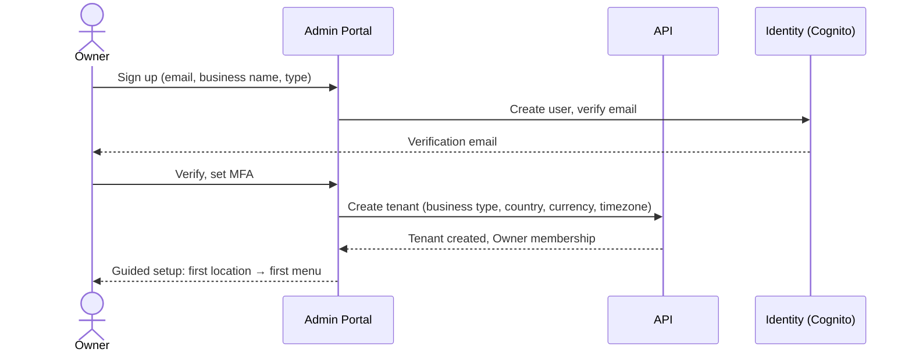
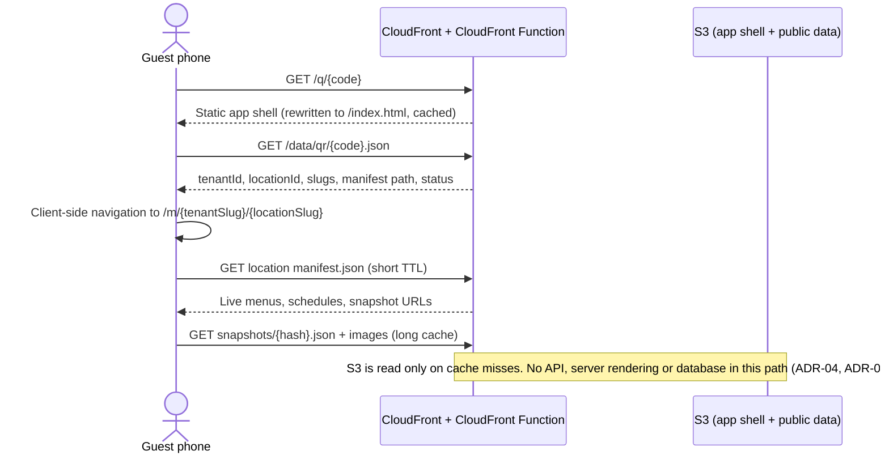

# 03 — User Roles and User Journeys

Tags: [S] stated · [D] derived · [A] assumption, needs confirmation · [R] recommendation
**Revision 0.3 (DRAFT, pending approval — doc 13):** open questions resolved (U4, U11); J3 per-menu publish lock, full-state rollback, unpublish; J6 sold-out via publish (overlay in phase 2); J2a in phase 2.
Revision 0.2: J1 creates locations (multiple supported); J2a marked as the first proposed AI capability; J5 updated for the fully static public path; J7–J8 out of MVP-1.

---

## 1. Actors

| Actor | Description | Tag | Authenticated? |
|-------|-------------|-----|----------------|
| **Guest / Customer** | Scans QR, views menu (and orders, if in scope). | [S] | No (anonymous) |
| **Tenant Owner** | Signs the business up; full control, including billing and deletion. | [D] | Yes, MFA |
| **Tenant Admin** | Manages menus, staff, locations; no billing/deletion. | [A] | Yes, MFA |
| **Menu Editor** | Edits catalogue and menus; may or may not publish (see below). | [A] | Yes |
| **Location Staff** | Marks items sold out; handles orders (if in scope). Scoped to one or more locations. | [A] | Yes |
| **Platform Admin** | MenuX operations staff: tenant management, plans, suspension. | [D] | Yes, MFA, SSO |
| **Platform Support** | Read-only tenant access for support, time-limited and logged. | [D] | Yes, MFA, SSO |
| **System actors** | Payment provider webhooks, AI worker, schedulers. | [D] | Machine credentials |

**Proposed decisions (Rev 0.3 draft, pending approval):**
- **No publish approval workflow** in MVP-1 (U11). Control comes from the `menu.publish` permission; a `PENDING_APPROVAL` step can be added later.
- **No level above tenants** in MVP-1 (U4). A chain is one tenant with many locations; hotel outlets are locations.
- Customers don't log in in MVP-1.

## 2. Permission matrix (proposed)

| Capability | Owner | Admin | Editor | Location Staff | Platform Support | Platform Admin |
|---|:-:|:-:|:-:|:-:|:-:|:-:|
| Manage billing / plan | ✅ | — | — | — | 👁 | ✅ |
| Delete tenant | ✅ | — | — | — | — | ✅ (with process) |
| Invite / remove users | ✅ | ✅ | — | — | — | — |
| Manage locations | ✅ | ✅ | — | — | 👁 | — |
| Edit catalogue & menus | ✅ | ✅ | ✅ | — | 👁 | — |
| Publish menu | ✅ | ✅ | ⚙ configurable | — | — | — |
| Use AI assist | ✅ | ✅ | ✅ | — | — | — |
| Mark item sold out | ✅ | ✅ | ✅ | ✅ (own locations) | — | — |
| Manage QR codes | ✅ | ✅ | — | — | 👁 | — |
| View/handle orders* | ✅ | ✅ | — | ✅ (own locations) | 👁 | — |
| Refund* | ✅ | ✅ | — | — | — | — |

👁 = read-only, logged · ⚙ = tenant setting · * = only if ordering in scope

Implementation recommendation [R]: model this as **permissions** (e.g., `menu.publish`) granted through roles, with an optional location scope. Don't hard-code role-name checks, so custom roles can be added later without rewrites.

---

## 3. User journeys

Journeys J1–J5 cover confirmed scope. J6–J9 depend on decisions still open.

### J1 — Tenant onboarding (confirmed)
**Actor:** Tenant Owner

Acceptance points:
- A tenant is created **only after** email verification, which limits spam signups.
- Country is captured at signup and selects the **market pack** (currency, languages and text direction, allergen scheme, price display; ADR-19, draft). Timezone and default language are captured too. [D]
- The guided setup creates the first location. More locations can be added at any time (ADR-13). Each location has its own timezone and URL slug.
- **Decided (2026-11-23, product owner): self-service signup.** Anyone can create an account (identity-provider hosted registration); the email must be verified before a tenant can be created; the creator becomes the Owner. **Free trial and card at signup: pending the billing phase** (subscription or eligible trial will be required; no rules defined yet; U7).

### J2 — Build a menu (confirmed)
**Actor:** Admin/Editor
1. Create a menu ("Dinner") and add sections ("Starters", "Mains").
2. Add items, either new or reused from the catalogue [A], with name, description, price, image, allergens [A].
3. Reorder by drag-and-drop.
4. Every save is a draft with version checking. If two editors clash, the second save gets a "changed by someone else, reload/merge" message. [D]
5. Preview the customer view on a phone-sized frame.

**Alternative J2a — AI import (first AI capability, accepted; phase 2 — ADR-15):** upload a photo/PDF of an existing menu → background job → AI-proposed sections/items appear in a **review screen**. The editor accepts, edits or rejects each one → accepted items become drafts.

### J3 — Publish a menu (confirmed)
1. Editor/Admin clicks **Publish**.
2. System validates: required fields, prices present, images processed, allergen fields completed (if required by market).
3. System creates an **immutable version** and a published JSON snapshot. The CDN serves it within 60 s.
4. Publish history shows who published what and when (last 50 versions). Rollback restores the full published state of an earlier version (content, schedule, locations). [R]
5. Only one publish, rollback or unpublish per menu runs at a time. A second request gets "publishing in progress"; a double click returns the same job. A failed publish can simply be retried.
6. **Unpublish** takes a live menu offline at all its locations; it's required before archiving or deleting a live menu.
7. The editor sees "Published, going live…" after the commit and "Live" once every location's public files are rebuilt (guests see it within ~30 s, by cache TTL).

### J4 — Generate and print QR codes (confirmed)
1. Admin opens *QR codes* → selects location (and table [A]).
2. System creates a short code mapped to a **stable URL** (`https://<public-domain>/q/{code}`).
3. Downloads PNG/SVG/PDF print sheet.
4. Later menu changes never require reprinting. The code resolves to whatever is currently published.

### J5 — Customer views menu (confirmed — critical path)
**Actor:** Guest

- No login, no app, no cookie banner needed if no tracking cookies are used. [R]
- Must work on slow networks and old phones (NFR-PERF-01).
- If schedules exist [A], the client chooses the active menu using the **venue's timezone**, not the phone's.
- Language switch [A] and allergen filter [A].
- **Edge cases:** QR revoked → friendly "menu unavailable" page; tenant suspended → generic page with no tenant data shown; nothing published → "coming soon"; unknown code → "not found" (misses are rate-monitored, doc 09 §4.6).
- Opening `/m/{tenantSlug}/{locationSlug}` directly (a shared link) skips the QR file and reads the route file `/data/routes/{tenantSlug}/{locationSlug}.json` instead.

### J6 — Mark item sold out (U6)
**MVP-1:** an editor sets the `soldOut` flag on the placement and publishes; guests see "sold out" within ~1 minute.
**Phase 2:** Location Staff mark an item sold out with one tap; it shows within seconds through a separate **availability overlay** file, without republishing (doc 04 §4.3).

### J7 — Customer places an order [Out of MVP-1 — Rev 0.2 #7; kept for future design]
1. Guest adds items/modifiers to a cart (client-side).
2. Submit → API **recalculates all prices server-side** from the published version the guest saw.
3. If payment is required: redirect to PSP hosted checkout → webhook confirms → order `PAID`.
4. Staff order board receives the order (WebSocket/SSE) → statuses: `RECEIVED → ACCEPTED → READY → COMPLETED` / `REJECTED`.
5. Guest sees status on a link-based page (no login).

Open: order types; tips; taxes (inclusive/exclusive); service charges; minimum order; opening hours enforcement; what happens if an item is 86'd after it's in the cart.

### J8 — Staff handle orders [Out of MVP-1 — Rev 0.2 #7]
Real-time board per location; sound/notification; accept/reject with reason; print ticket (printer integration is **out of scope** unless required).

### J9 — Platform support investigates a tenant issue [D]
1. Support searches for the tenant in the platform console.
2. Requests a time-limited read-only "view as tenant" session (reason required).
3. Every action is written to an audit log the tenant can see. [R]
